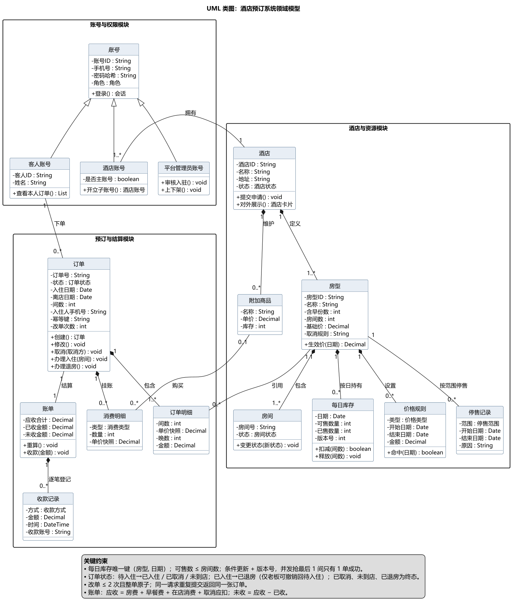
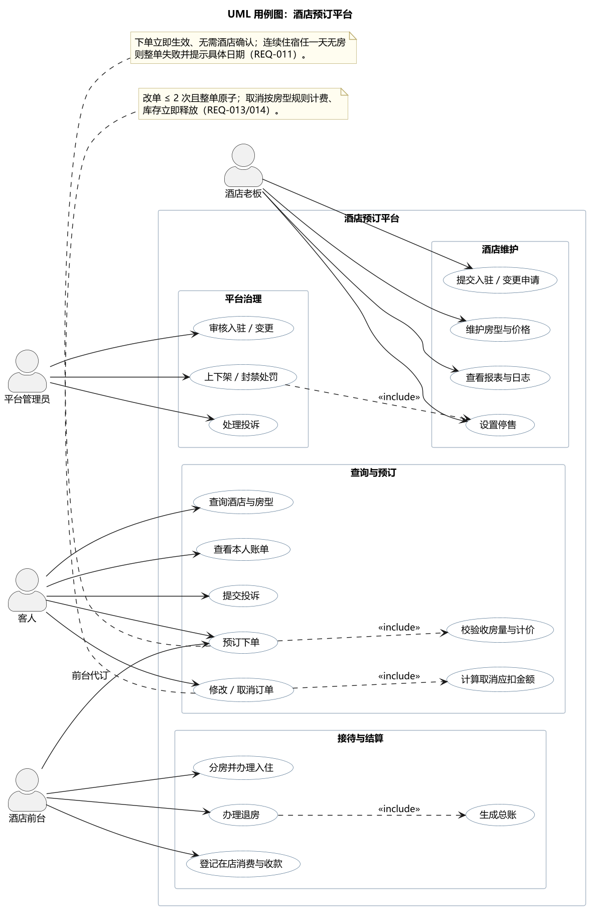
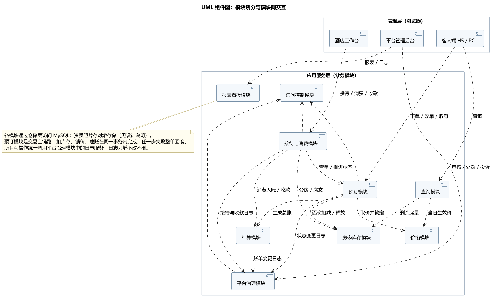
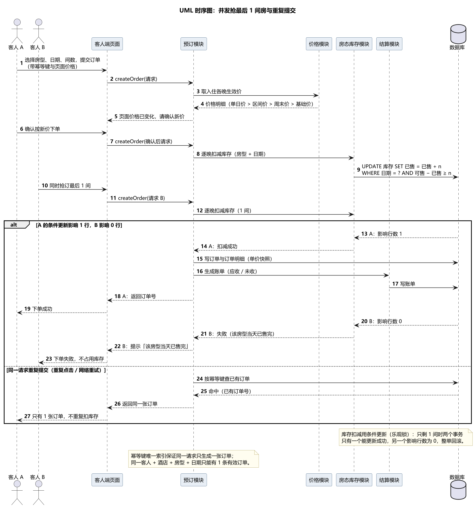
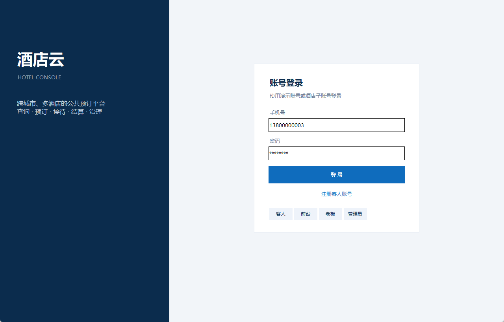
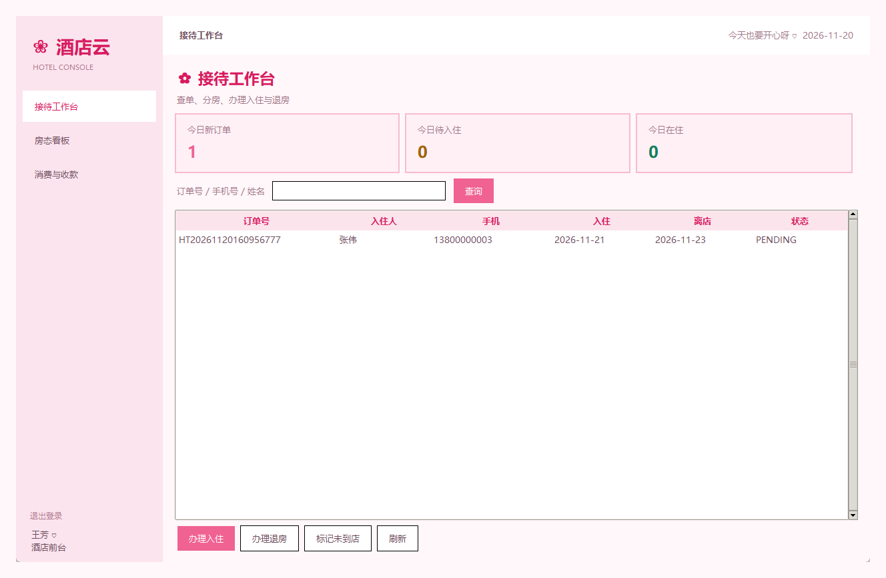
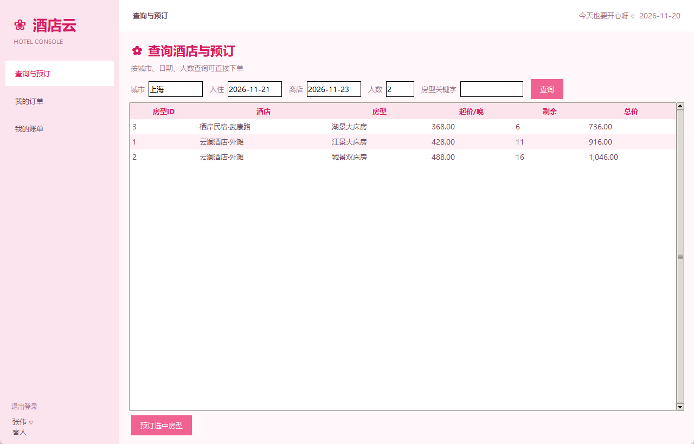

# 实验三 软件实现与构建

## ——酒店预订系统的 UML 实现与工程化构建

| 项目 | 内容 |
|---|---|
| 学 院 | 计算机学院 |
| 专 业 | 软件工程 |
| 学 号 | 241220081 |
| 姓 名 | 刘子健 |
| 日 期 | 2026 年 11 月 |

> **使用说明（提交前请删除本节）**
>
> 本文件是与 `实验报告_可填写模板.docx` 内容一致的 Markdown 版模板：封面、章节、图表、数据表已经准备好，正文中以 **【】** 标出的位置需要由本人撰写。
>
> 实验三 PDF 第 3.1 节明确写着“实验报告的书写不允许使用大模型的辅助”。因此本模板只提供结构、事实数据和图表，不包含可直接提交的正文；请用自己的话补全【】中的内容，删除本节后再导出最终 PDF。
>
> 模板中的代码规模、测试、pylint、Git 提交、界面截图均来自本仓库的实际运行结果，数据来源见 `docs/报告素材.md`。

---

## 摘 要

> **【请写 200~300 字：项目背景、实现了哪些角色与业务、代码规模、测试与运行结果、你觉得最值得说明的一点】**

**关键词：** 酒店预订；UML；Python；SQLite；Tkinter；单元测试

---

## 一、实验任务与项目概述

> **【用自己的话说明实验三的任务：把实验二的 UML 设计落地为可运行软件，并完成编译、测试、Git 管理与报告】**

> **【介绍酒店预订系统的业务范围：客人、前台、老板、平台管理员四类角色，以及查询、预订、接待、结算、治理五块业务】**

> **【说明技术选型及理由：Python 3.12 + SQLite + Tkinter，为什么适合本次实验】**

---

## 二、UML 设计回顾

实验二共保留 4 张核心 UML 图：类图、用例图、组件图、时序图（并发下单）。

> **【用 1~2 段说明这 4 张图分别约束了实现的哪些方面，以及实验三是否对设计做了微调】**

---

## 三、从 UML 到代码的实现

### 3.1 总体实现思路

> **【描述你的落地顺序：先实体与表结构，再仓储与领域规则，再服务，最后界面；说明为什么这样排序】**

> **【说明分层：界面层、服务层、领域/数据层各自负责什么，依赖方向如何】**

### 3.2 类图 → 领域模型与数据表

| 实验二类图中的元素 | 代码落点 | 实现说明 |
|---|---|---|
| 账号、酒店、房型、房间 | `db.py` 的 `accounts` / `hotels` / `room_types` / `rooms` 表 | 唯一键与外键按类图约束 |
| 每日库存 | `inventory` 表（`room_type_id + date` 主键） | `total` / `sold` / `version` 支持条件扣减 |
| 订单、订单夜、订单房间 | `orders` / `order_nights` / `order_rooms` | `order_nights` 保存价格快照 |
| 账单、支付、消费 | `bills` / `payments` / `consumptions` | 已收 + 未收 = 应收 |
| 投诉、日志、快照 | `complaints` / `operation_logs` / `snapshots` | 日志只增不改 |
| 订单状态机 | `domain.py` 的 `ORDER_TRANSITIONS` | 服务层统一校验状态转换 |

> **【挑 1~2 个类，说明字段/约束是如何从类图推出来的；例如订单状态为什么需要状态机、库存为什么按天建行】**

> **【说明枚举与状态机放在 `domain.py` 的好处，以及你遇到的建模取舍】**

### 3.3 用例图 → 界面与用例实现

| 用例 | 界面入口 | 服务方法 |
|---|---|---|
| 查询酒店/房型 | 客人 → 查询与预订 | `BookingService.search` |
| 下单/改单/取消 | 客人 → 我的订单 | `create_order` / `modify_order` / `cancel_order` |
| 入住/退房 | 前台 → 接待工作台 | `check_in` / `check_out` / `mark_no_show` |
| 消费/收款 | 前台 → 消费与收款 | `add_consumption` / `BillingService.add_payment` |
| 房型/价格/停售 | 老板 → 房型与房间、价格与停售 | `HotelAdminService` |
| 审核/投诉/审批 | 管理员 → 入驻审核、投诉处理、调价审批 | `review` / `handle` / `approve_price` |

> **【说明你如何把用例图中的参与者映射为角色权限，以及界面上的哪些按钮对应哪些服务方法】**

> **【举一个“界面只做收集参数、业务规则放服务层”的例子】**

### 3.4 组件图 → 模块划分

| 组件 | 文件 | 职责 |
|---|---|---|
| 预订组件 | `booking.py` | 下单、改单、取消、入住、退房 |
| 库存组件 | `inventory.py` | 每日可售校验、扣减、释放 |
| 价格组件 | `pricing.py` | 单日 > 区间 > 周末 > 基础价 |
| 结算组件 | `billing.py` | 账单重算、收款、作废 |
| 接待组件 | `frontdesk.py` | 房态、消费退款 |
| 酒店维护组件 | `hotel_admin.py` | 房型、价格、停售、员工、审核 |
| 治理组件 | `governance.py` / `audit.py` | 投诉、操作日志 |
| 报表组件 | `reports.py` | 营收、出租率、看板、快照 |

> **【说明组件之间的依赖关系，为什么库存/价格/结算要被多个组件复用】**

> **【说明 Repository 在组件之间起什么作用，是否出现过循环依赖】**

### 3.5 时序图 → 事务与并发控制

> **【按并发下单时序图，描述一次下单的调用链：界面 → BookingService → InventoryService → Repository → SQLite】**

> **【重点解释：为什么用 `UPDATE ... WHERE total - sold >= ?` 的条件更新，而不是先查再改；失败时如何回滚】**

> **【说明幂等键、改单先释放再扣减、取消释放库存分别解决什么问题】**

| 并发/一致性问题 | 实现手段 | 对应时序图消息 |
|---|---|---|
| 同一晚超卖 | 条件 UPDATE + 事务 | reserveInventory |
| 重复提交 | `idempotency` 表 + 唯一键 | createOrder |
| 改单部分成功 | `with conn` 整单事务 | release / reserve |
| 取消后库存不释放 | `cancel_order` 中逐晚 release | releaseInventory |
| 账单金额不一致 | 每次变更后 rebuild | recalculateBill |

### 3.6 源代码规模

统计口径：`hotel_booking` 包内 `.py` 文件的非空行；不含空行。

| 文件 | 非空行 | 物理行 | 说明 |
|---|---:|---:|---|
| `gui.py` | 1,402 | 1,519 | Tkinter 桌面界面 |
| `cli.py` | 484 | 520 | 命令行界面 |
| `booking.py` | 494 | 520 | 预订与订单状态 |
| `hotel_admin.py` | 459 | 490 | 酒店维护与审核 |
| `db.py` | 394 | 441 | 建表与演示数据 |
| `repository.py` | 655 | 738 | 数据访问 |
| `reports.py` | 165 | 179 | 报表 |
| `billing.py` | 132 | 142 | 账单与收款 |
| 其他 13 个文件 | 699 | 873 | 领域、工具、服务等 |
| **合计** | **4,884** | **5,422** | 不含测试与第三方库 |

> **【说明这个规模是否达到 1,500 行要求，以及你如何统计（工具/命令）、是否包含自动生成代码】**

测试代码：`tests/test_booking.py`、`tests/test_admin.py`，共 25 个测试，非空 353 行。

---

## 四、大模型辅助代码实现

### 4.1 使用了哪些工具、怎么用

> **【写清楚工具名称、使用方式（对话/补全）、你给它的输入（UML、需求、错误日志）】**

> **【说明你如何拆任务：先让它生成什么，再生成什么，哪些部分坚持自己写】**

### 4.2 大模型具体帮你做了哪些工作

| 次数 | 场景 | 生成内容 | 你的处理 |
|---:|---|---|---|
| 1 | 领域模型与建表 | 实体字段、SQLite 建表、仓储草稿 | 补 `price_approvals` 表；调整价格快照 |
| 2 | 服务层 | 预订/改单/取消/入住/结算初版 | 补权限校验、回滚、幂等 |
| 3 | 单元测试 | 15 个测试草稿 | 修正周末价/取消时限假设，补 10 个管理端测试 |
| 4 | 代码风格 | black 格式化、pylint 修复建议 | 删未用导入、拆长行、补 docstring |
| 5 | 演示与文档 | 演示脚本、README、报告素材 | 修正跨酒店入住、核对账单口径 |
| 6 | 桌面界面 | Tkinter 页面骨架与表单 | 修登录后旧导航引用，补演示订单 |
| 7 | 界面主题 | 粉色渐变、小兔子、表头与按钮配色 | 修侧边栏/表头样式，补渐变与兔子 |
| 8 | 可执行文件 | cmd/vbs/pyw 启动器与打包命令 | 改 ASCII 启动器，实测 exe 窗口 |

### 4.3 生成不符合预期时怎么处理

> **【至少写 2 个具体例子：大模型生成了什么、哪里不对、你怎么定位、最后怎么改】**

> **【可以写：测试假设错误、跨酒店权限缺失、取消账单未清零、cmd 中文路径编码错误等】**

> **【总结你对“大模型能做什么、不能做什么”的判断】**

---

## 五、编译与运行结果

环境：Windows 11 / Python 3.12.14 / SQLite 3.53.1 / pytest 9.2.0 / pylint 4.1.4。

| 检查 | 命令 | 结果 |
|---|---|---|
| 语法编译 | `python -m compileall -q hotel_booking main.py` | 退出码 0 |
| 单元测试 | `python -m pytest -q` | 25 passed，约 8 秒 |
| 代码风格 | `python -m pylint hotel_booking` | 10.00/10 |
| 演示运行 | `python main.py --demo --db :memory:` | 完整流程正常结束 |
| 桌面启动 | 双击 `启动界面.cmd` / `酒店预订系统.exe` | 窗口正常打开 |

> **【贴 10~20 行关键运行输出（下单、改单、入住、收款、取消），并解释输出说明什么】**

> **【说明测试覆盖了哪些风险点，有没有还没覆盖的部分】**

> **【如果运行失败过，写失败现象、定位过程、修复结果】**

---

## 六、Git 远程代码管理

仓库：`https://github.com/whitecut/software-engineering-lab.git`；分支：`lab3`；标签：`lab3-final`。

| 提交 | 说明 |
|---|---|
| `66b5408` | 领域模型、SQLite 表结构与数据访问层 |
| `425cda5` | 业务服务、CLI 交互与 25 个单元测试 |
| `b1eb053` | UML 副本、运行结果、测试与代码风格数据 |
| `1155d1e` | 补充推送脚本与 Git 说明 |
| `2542185` | 记录编译结果 |
| `a4a92d9` | 增加 Tkinter 桌面界面与界面截图 |
| `14139f2` | 界面改为粉色少女心主题 |
| `4da7bbf` | 增加双击启动器与独立 exe |
| `f9e9764` | 清理临时截图 |
| `def878a` | 增加可填写实验报告模板与 PDF |

> **【说明你如何分阶段提交、提交信息怎么写、有没有用分支/标签】**

> **【贴 GitHub 仓库页面或 `git log` 截图；如果还没推送，写清楚当前状态和原因】**

---

## 七、遇到的问题与改进方向

> **【列 3~4 个实现中遇到的问题：现象、原因、解决方式、学到什么】**

> **【写当前原型的不足：单房型订单、SQLite、未接真实支付、未做 Web 端等】**

> **【如果继续做，下一步优先做什么】**

---

## 八、总结

> **【用 2~3 段总结：UML 对实现的帮助、大模型辅助的边界、工程化收获】**

> **【写你认为本次实验最有价值的一次修改，以及为什么】**

---

## 附录 A：25 个测试覆盖点

价格优先级；搜索排序；下单扣库存/幂等/取消释放；逐晚扣减失败回滚；改单价格快照/2 次上限/无房原子失败；取消扣费；重复分房拦截；账单与分次收款；停售拦截；房态转换；投诉流程；手机号脱敏与留痕；角色越权；报表与快照；酒店审核；调价审批与过期；前台代订；未到店；消费退款；账单作废；员工子账号。

## 附录 B：运行输出节选

完整输出见 `docs/运行结果.txt`；测试输出见 `docs/pytest结果.txt`；代码风格输出见 `docs/pylint结果.txt`。

> **【粘贴你认为最能说明问题的一段输出】**
