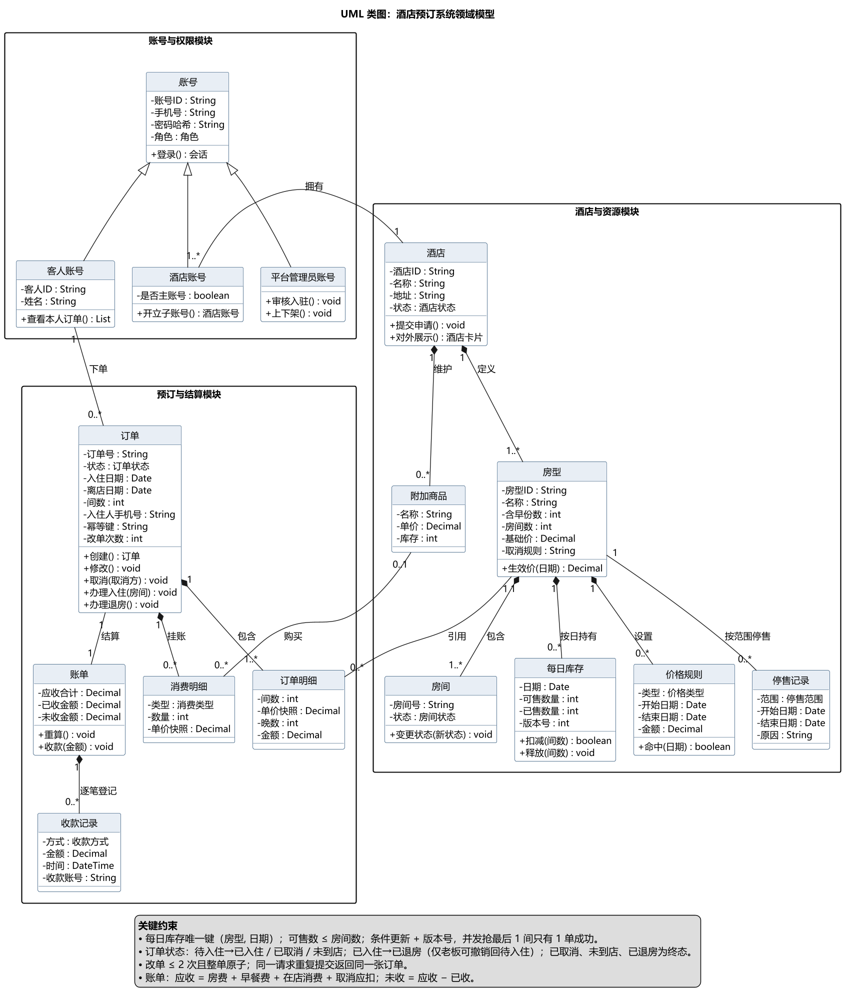
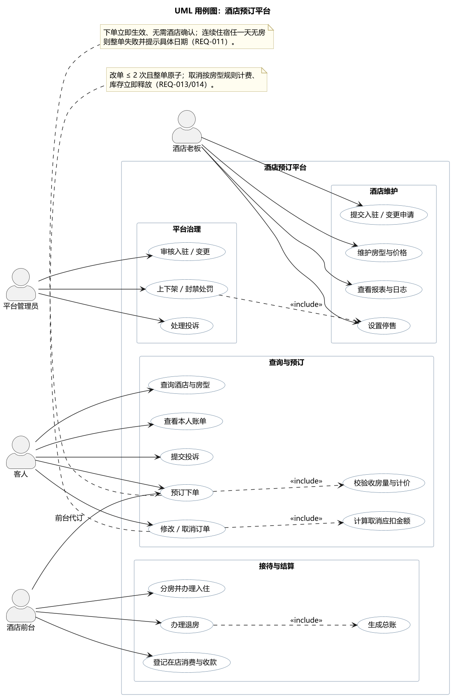
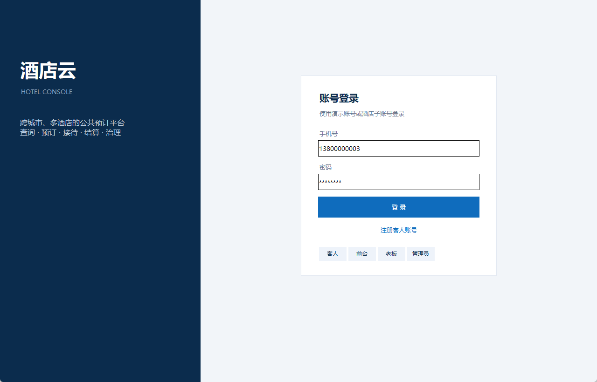

# 实验三  软件实现与构建

## ——酒店预订系统的 UML 实现与工程化构建

| 学    院 | 计算机学院 |
|---|---|
| 专    业 | 软件工程 |
| 学    号 | 241220081 |
| 姓    名 | 刘子健 |

2026 年 11 月

## 摘  要

本实验以实验二的酒店预订系统 UML 设计为输入，使用 Python 3.12、SQLite 与 Tkinter 完成了一个可运行的桌面原型。系统覆盖客人、酒店前台、酒店老板、平台管理员四类角色，实现了酒店查询、下单、改单、取消、分房入住、在店消费、分次收款、退房结算、投诉处理、调价审批、报表与审计日志等业务。实现重点放在 UML 约束的落地：用订单状态机限制状态转换，用每日库存行与条件更新防止超卖，用幂等键避免重复下单，用整单事务保证改单的原子性，用订单夜价格快照保证改单前后价格一致，用账单重算保证“应收 = 已收 + 未收”。最终源码 4,884 行非空代码（5,422 物理行），配套 25 个单元测试，pylint 10.00/10，编译与演示运行均通过，并打包了不依赖本机 Python 的单文件 exe。报告同时记录了大模型在代码骨架、服务实现、测试、界面与打包中的使用过程，以及若干“生成结果不符合预期”时的定位与修正。

关键词：酒店预订；UML；Python；SQLite；Tkinter；单元测试；大模型辅助

## 一、实验任务与项目概述

### 1.1 实验任务

实验三要求把实验二完成的 UML 设计转换为可编译、可运行、可测试的软件，并完成代码规模统计、代码风格检查、Git 版本管理与实验报告。与实验二侧重“设计是否正确”不同，实验三更关注“设计能否落地”：类图中的实体是否变成合理的表结构，用例图中的业务是否都有入口，组件图中的模块是否真的解耦，时序图中的并发与事务是否在代码中实现。

因此我没有把实验三当成一次“重新写一个项目”，而是把实验二的四张图当作约束逐条对照实现，每完成一层就回到图上检查：类图的每个关键类是否有落点，用例是否都能在界面或 CLI 中走通，时序图中的每个消息是否都有对应的方法调用。

### 1.2 业务范围

系统面向跨城市、多酒店的公共预订平台，包含四类角色和五块业务。客人可以按城市、日期、人数、房型关键字查询可订房型，选择房型后下单，查看订单与账单，在规则允许时改单或取消，并对已完成的订单提交投诉。

酒店前台负责接待：按订单号、手机号或姓名查单，给订单分配具体房间并办理入住，登记洗衣、早餐加购等在店消费，按现金或扫码分次收款，办理退房并把房间转为待打扫。酒店老板维护本酒店的房型、房间数、基础价、周末价/区间价/单日价、停售、附加商品和前台子账号，并查看营收、出租率、消费明细与操作日志。

平台管理员负责酒店入驻审核、下架/封禁、投诉处理、超过 5 倍的调价审批，以及平台级的酒店数、订单数、取消数与待处理投诉看板。五块业务分别对应查询与预订、接待、结算、酒店维护、平台治理，基本覆盖了实验二用例图中的 15 个主用例和 3 个包含用例。

### 1.3 技术选型

实现语言选择 Python 3.12。原因有三点：第一，实验二类图中的实体和规则可以用枚举、数据类与普通类较直观地表达；第二，标准库自带 sqlite3 与 tkinter，不需要额外安装数据库或 GUI 框架，便于在实验室机器上复现；第三，Python 的单元测试与静态检查工具链成熟，能较快形成“实现—测试—修复”的闭环。

数据库使用 SQLite 而不是实验二设计的 MySQL。这是本次实现最主要的简化：SQLite 单文件、零配置，适合单机原型和演示；表结构、唯一约束、外键和索引仍按类图设计，迁移到 MySQL 时只需调整连接层与少量 SQL 方言。界面使用 Tkinter 实现桌面端，同时保留 CLI，方便在无图形环境或自动化脚本中运行。运行时没有第三方依赖，pytest、pylint、black、PyInstaller 只用于开发和打包。

## 二、UML 设计回顾

### 2.1 四张核心图

实验二最终保留 4 张图：类图、用例图、组件图和“并发下单”时序图。类图把系统划分为账号与权限、酒店与资源、预订与结算三个模块，给出 16 个核心类及其关联；用例图给出 4 个参与者、15 个主用例和 3 个包含用例；组件图给出 9 个业务模块、3 个前端入口和数据库；时序图则把“同一晚最后 1 间房 + 同一请求重复提交”这两个最危险的场景画成了带 alt 分支的交互。


*图 2-1 类图（实验二最终版）*


*图 2-2 用例图（实验二最终版）*


*图 2-3 组件图（实验二最终版）*


*图 2-4 并发下单时序图（实验二最终版）*

### 2.2 设计对实现的约束

类图中有四条约束直接决定了代码结构。第一，每日库存以“房型 + 日期”为最小单位，因此库存表的主键必须是 (room_type_id, date)，不能只在房型上放一个总数；第二，订单状态只能按“待入住 → 已入住/已取消/未到店、已入住 → 已退房”转换，因此需要一个独立的状态机，而不是在界面里散落 if 判断；第三，同一订单最多改 2 次，且改单必须整单成功或整单失败；第四，账单必须满足“应收 = 房费 + 早餐 + 在店消费 + 取消应扣”，且“已收 + 未收 = 应收”。

用例图约束了权限边界：客人只能操作本人订单，前台只能处理本酒店订单，老板只能维护本酒店资源，管理员可以跨酒店审核与处理投诉。组件图约束了依赖方向：界面只调用服务，服务只通过 Repository 访问数据库，库存、价格、结算被多个服务复用，不能反过来依赖界面。时序图约束了并发与事务：扣库存必须是条件更新，重复请求必须命中幂等键，任何一步失败都要回滚整单。

### 2.3 实验三对设计的微调

落地过程中对实验二设计做了少量取舍，并在报告中明确说明。数据库由 MySQL 改为 SQLite；一个订单只支持一个房型，多房型订单留作扩展；调价审批实现了“超过 5 倍需审批、7 天未批自动失效”，但没有单独的审批进度页面；界面用 Tkinter 实现桌面端，没有做 Web 端；支付只记录现金/扫码，没有接入真实支付渠道。这些调整不影响类图的核心关系，也不改变用例图的主流程。

## 三、从 UML 到代码的实现

### 3.1 总体实现思路

我的落地顺序是“实体与表结构 → 仓储与领域规则 → 服务 → 界面”。先做数据层，是因为类图中的实体、唯一约束和关联最稳定，表结构一旦确定，后面服务层和界面层就有共同的词汇；先做领域规则，是因为订单状态、价格优先级、库存扣减这些规则如果拖到界面阶段再补，容易被按钮逻辑切碎；服务层按用例组织，一个用例一个方法，界面只负责收集参数和展示结果；最后做界面，是因为界面最容易变化，放在最后可以把变化隔离在表示层。

代码分为四层：gui.py 与 cli.py 是表示层，负责输入、输出和页面跳转；booking、billing、frontdesk、hotel_admin、governance、reports 是服务层，负责用例编排和权限校验；pricing、inventory、domain、security 是领域规则层，负责价格、库存、状态机与权限；db.py 与 repository.py 是数据访问层，负责建表、演示数据、SQL 与行对象转换。依赖方向始终是“表示层 → 服务层 → 仓储层 → SQLite”，服务层不 import 任何界面模块。

### 3.2 类图 → 领域模型与数据表

类图中的 16 个核心类落成了 19 张表。账号、酒店、房型、房间、库存、价格规则、停售、商品、订单、订单夜、订单房间、消费、账单、支付、投诉、操作日志、间夜快照、幂等记录、调价审批各有一张表。表之间的外键与类图中的关联对应：订单属于酒店与房型，订单夜属于订单，订单房间连接订单与房间，账单与支付是一对多，消费属于订单与商品。

| 实验二类图中的元素 | 代码落点 | 实现说明 |
|---|---|---|
| 账号、酒店、房型、房间 | db.py 的 accounts/hotels/room_types/rooms | 唯一键与外键按类图约束 |
| 每日库存 | inventory（room_type_id + date 主键） | total/sold/version 支持条件扣减 |
| 订单、订单夜、订单房间 | orders/order_nights/order_rooms | order_nights 保存价格快照 |
| 账单、支付、消费 | bills/payments/consumptions | 已收 + 未收 = 应收 |
| 投诉、日志、快照 | complaints/operation_logs/snapshots | 日志只增不改 |
| 订单状态机 | domain.py 的 ORDER_TRANSITIONS | 服务层统一校验状态转换 |

以订单为例，类图给出“订单号、状态、入住日期、离店日期、间数、入住人、手机号、改单次数”等属性，对应到 orders 表时，我把订单号设为唯一键，把状态存成字符串枚举，把改单次数存成整数并在服务层限制为 2。订单夜单独建表，是因为价格按天计算且改单时要保留旧价格：如果只存订单总价，改单后无法解释“为什么这一天是 488、另一天是 428”。库存按天建行，是为了让“最后 1 间房”的竞争落在同一行上，条件更新才能生效。

状态机放在 domain.py 的 ORDER_TRANSITIONS 中，服务层只调用 _check_transition。这样做的好处是：界面不需要知道合法状态，报表也不需要重复判断；新增状态时只改一处，所有服务自动生效。房间状态也采用同样做法，ROOM_TRANSITIONS 限制“待打扫 → 空房、空房 → 维修、维修 → 空房”等转换，禁止前台手工把房间置为在住。

### 3.3 用例图 → 界面与用例实现

用例图的四个参与者直接映射为四种角色，登录后进入不同工作台。客人端有“查询与预订、我的订单、我的账单”三个页面；前台端有“接待工作台、房态看板、消费与收款”；老板端有“房型与房间、价格与停售、商品与员工、报表看板、操作日志”；管理员端有“入驻审核、投诉处理、调价审批、平台概览”。每个页面上的主按钮都对应一个服务方法，界面不直接写 SQL。


*图 3-1 桌面端登录页（实际运行截图）*


*图 3-2 前台接待工作台（实际运行截图）*

| 用例 | 界面入口 | 服务方法 |
|---|---|---|
| 查询酒店/房型 | 客人 → 查询与预订 | BookingService.search |
| 下单/改单/取消 | 客人 → 我的订单 | create_order / modify_order / cancel_order |
| 入住/退房 | 前台 → 接待工作台 | check_in / check_out / mark_no_show |
| 消费/收款 | 前台 → 消费与收款 | add_consumption / BillingService.add_payment |
| 房型/价格/停售 | 老板 → 房型与房间、价格与停售 | HotelAdminService |
| 审核/投诉/审批 | 管理员 → 入驻审核、投诉处理、调价审批 | review / handle / approve_price |

权限不是在界面里判断的，而是在服务层统一用 require_role 和酒店归属校验。例如 check_in 会检查操作者是否前台/老板、订单是否属于本酒店、房间是否属于本酒店、房间房型是否与订单一致、房间状态是否为空房/已预订、该房间在入住日期是否已分配给其他订单。界面只负责把订单号和房间号传进来，任何一条校验失败都会抛出 DomainError，由界面统一弹出提示。这样即使用 CLI 或脚本绕过界面，规则仍然生效。

以“前台代订”为例：客人自己下单时 customer_id 记录当前账号；前台代订时 customer_id 为空，但订单仍记录入住人姓名和手机号，并标记 source=DESK。这个例子说明界面只做参数收集，“谁能代订、能订哪个酒店、间数是否超过房型上限”这些规则全部在 BookingService 中。

### 3.4 组件图 → 模块划分

组件图中的 9 个模块落成了 8 个服务文件和 1 个报表文件。预订组件负责订单生命周期，库存组件负责每日可售与扣减，价格组件负责优先级计算，结算组件负责账单与收款，接待组件负责房态与消费退款，酒店维护组件负责房型/价格/停售/员工/审核，治理组件负责投诉与日志，报表组件负责营收、出租率、看板与快照。

| 组件 | 文件 | 职责 |
|---|---|---|
| 预订组件 | booking.py | 下单、改单、取消、入住、退房 |
| 库存组件 | inventory.py | 每日可售校验、扣减、释放 |
| 价格组件 | pricing.py | 单日 > 区间 > 周末 > 基础价 |
| 结算组件 | billing.py | 账单重算、收款、作废 |
| 接待组件 | frontdesk.py | 房态、消费退款 |
| 酒店维护组件 | hotel_admin.py | 房型、价格、停售、员工、审核 |
| 治理组件 | governance.py / audit.py | 投诉、操作日志 |
| 报表组件 | reports.py | 营收、出租率、看板、快照 |

组件之间通过 Repository 共享数据访问，但不会互相 import 具体实现。库存、价格、结算被预订、接待、酒店维护多个组件复用，因此它们被做成独立服务，而不是塞进 BookingService。依赖关系是单向的：booking 依赖 inventory/pricing/billing，frontdesk 依赖 billing/repository，hotel_admin 依赖 repository/audit，reports 只读 repository。这样的划分让每个组件都能单独测试，也避免了“库存改一行、预订和报表都要改”的连锁反应。

### 3.5 时序图 → 事务与并发控制

并发下单时序图是本次实现最核心的一段。一次下单的调用链是：界面收集房型、日期、间数、入住人信息，调用 BookingService.create_order；服务先校验日期、房型、酒店状态、间数，再调用 InventoryService.check_available 逐晚检查库存与停售；随后在一个 with conn 事务中逐晚执行 Repository.deduct，扣减成功后再写订单、订单夜和账单，最后写幂等记录并记日志。任何一晚扣减失败都会抛异常，事务回滚，已经扣掉的库存也一起恢复。

库存扣减使用一条带条件的 UPDATE：UPDATE inventory SET sold = sold + ?, version = version + 1 WHERE room_type_id = ? AND date = ? AND total - sold >= ?。数据库保证同一行的更新是原子的，因此两个并发请求只有一个能成功；另一个的 rowcount 为 0，服务层把它转成“该日期已售完”。这比“先 SELECT 再 UPDATE”可靠，因为后者在两步之间可能被另一个事务插入。

```text
UPDATE inventory
   SET sold = sold + ?, version = version + 1
 WHERE room_type_id = ? AND date = ?
   AND total - sold >= ?;
```

重复提交用 idempotency 表解决：下单前先按幂等键查已有订单，命中就直接返回；未命中则在同一个事务中写订单和幂等记录。这样即使客户端因为网络重试两次，也只会产生一张订单。改单则采用“先释放旧库存，再校验并扣减新库存”的顺序，整个改单仍在一个事务中；如果新日期无房，事务回滚，旧库存和旧订单都不变。取消订单会逐晚释放库存，并按取消规则计算首晚房费；账单重算后只保留取消应扣，房费归零。

| 并发/一致性问题 | 实现手段 | 对应时序图消息 |
|---|---|---|
| 同一晚超卖 | 条件 UPDATE + 事务 | reserveInventory |
| 重复提交 | idempotency 表 + 唯一键 | createOrder |
| 改单部分成功 | with conn 整单事务 | release / reserve |
| 取消后库存不释放 | cancel_order 中逐晚 release | releaseInventory |
| 账单金额不一致 | 每次变更后 rebuild | recalculateBill |

### 3.6 源代码规模

统计口径是 hotel_booking 包内所有 .py 文件的非空行，不含空行；测试代码单独统计。统计命令为 PowerShell 的 Get-Content 过滤空白行后计数，再按文件汇总。GUI 是手写 Tkinter，不是设计工具自动生成；PyInstaller 生成的 exe 不计入代码规模。

| 文件 | 非空行 | 物理行 | 说明 |
|---|---|---|---|
| gui.py | 1,402 | 1,519 | Tkinter 桌面界面 |
| cli.py | 484 | 520 | 命令行界面 |
| booking.py | 494 | 520 | 预订与订单状态 |
| hotel_admin.py | 459 | 490 | 酒店维护与审核 |
| db.py | 394 | 441 | 建表与演示数据 |
| repository.py | 655 | 738 | 数据访问 |
| reports.py | 165 | 179 | 报表 |
| billing.py | 132 | 142 | 账单与收款 |
| 其他 13 个文件 | 699 | 873 | 领域、工具、服务等 |
| 合计 | 4,884 | 5,422 | 不含测试与第三方库 |

最终非空代码 4,884 行、物理行 5,422 行，明显超过实验要求的 1,500 行。其中界面相关约 1,886 行，业务服务约 1,412 行，领域/数据/工具约 1,586 行。测试代码 tests/test_booking.py 与 tests/test_admin.py 共 25 个测试、353 行非空代码。

## 四、大模型辅助代码实现

### 4.1 工具与使用方式

本次实现使用 DeepSeek 作为对话式编程助手，配合本机的 Python、SQLite、pytest、pylint、black、PlantUML 与 PyInstaller 工具链。使用方式不是“让它一次写完整项目”，而是把实验二的 UML、需求条目、错误日志作为输入，按“生成骨架 → 运行 → 测试 → 修复 → 再审阅”的循环推进。每次只让它负责一个边界清晰的任务，例如“根据类图生成 accounts/hotels/room_types 三张表的建表语句”，而不是“把整个系统写出来”。

我坚持自己决定四类内容：表结构与唯一约束、订单/房间状态机、并发扣减与事务边界、以及最终是否接受一段生成代码。大模型负责把这些决定翻译成代码草稿、补全重复的 CRUD、生成测试样例、解释报错和给出重构建议。这样既能利用它的速度，又不会把业务不变量交给它“猜”。

### 4.2 大模型具体做了哪些工作

| 次数 | 场景 | 生成内容 | 人工处理 |
|---|---|---|---|
| 1 | 领域模型与建表 | 实体字段、SQLite 建表、仓储草稿 | 补 price_approvals 表；调整价格快照 |
| 2 | 服务层 | 预订/改单/取消/入住/结算初版 | 补权限校验、回滚、幂等 |
| 3 | 单元测试 | 15 个测试草稿 | 修正周末价/取消时限假设，补 10 个管理端测试 |
| 4 | 代码风格 | black 格式化、pylint 修复建议 | 删未用导入、拆长行、补 docstring |
| 5 | 演示与文档 | 演示脚本、README、报告素材 | 修正跨酒店入住、核对账单口径 |
| 6 | 桌面界面 | Tkinter 页面骨架与表单 | 修登录后旧导航引用，补演示订单 |
| 7 | 界面主题 | 粉色渐变、小兔子、表头与按钮配色 | 修侧边栏/表头样式，补渐变与兔子 |
| 8 | 可执行文件 | cmd/vbs/pyw 启动器与打包命令 | 改 ASCII 启动器，实测 exe 窗口 |

第一轮主要生成实体与建表语句。它很快给出了 hotels、accounts、room_types、rooms、inventory、orders 等表的初稿，但我发现两个问题：调价审批没有表，价格快照只存了订单总价。于是我补了 price_approvals 表，并把订单夜拆成 order_nights，每晚存一条价格。第二轮生成服务层，它给出的下单流程是“先查库存再扣减”，我改成条件 UPDATE，并补了幂等键和整单事务。第三轮生成测试，它默认所有日期都是基础价、取消都免费，这两个假设在真实数据上不成立，测试直接失败，后面 4.3 节会详细说明。

第四轮用 black 统一格式、用 pylint 找问题，初版得分只有 9.36，主要是未使用导入、超长行、缺少函数 docstring。我按提示逐项清理，最后把 pylint 配置为只关闭设计类检查（参数过多、分支过多等），得分达到 10.00。第五轮生成演示脚本和 README；第六、七轮生成桌面界面和粉色主题；第八轮生成双击启动器与 PyInstaller 命令。每一轮都先跑测试或实际启动，确认没有破坏已有功能再继续。

### 4.3 生成不符合预期时的处理

第一个典型问题是测试假设错误。大模型生成的取消扣费测试默认“提前取消一定免费”，但代码的规则是“入住前一天 18:00 前免费，之后收首晚房费”。测试在下午运行，对“明天入住”的订单仍然免费，于是断言失败。我没有改业务规则去迁就测试，而是把测试改成从订单夜读取实际首晚价格，并用“今天入住”的订单验证收费分支。这让我意识到：大模型能写出“看起来合理”的测试，但测试里的业务假设必须由人核对。

第二个问题是权限遗漏。初版 check_in 只校验订单状态和房间状态，没有校验订单是否属于当前前台所在酒店。这意味着 A 酒店前台可以给 B 酒店订单办理入住。发现后我在服务层补了 hotel_id 校验，并加了一条跨酒店入住的测试。类似地，order_detail 最初允许老板查看任意酒店订单，后来补了“只能查看本酒店”的限制，老板视角默认脱敏手机号，查看全号会写 VIEW_FULL_PHONE 日志。

第三个问题是取消账单。初版账单重算仍然把订单夜算进房费，导致取消后的账单同时有房费和取消应扣，总额翻倍。修正方式是在 BillingService.compute 中判断订单状态：已取消订单的房费、早餐、在店消费都归零，只保留 cancel_fee。这个例子说明“账单 = 各项之和”这种看似简单的规则，跨状态时很容易漏。

第四个问题是 Windows 启动器的中文路径。最初把 start 命令和 exe 路径写进 .cmd，但 cmd 使用 GBK 代码页读取 UTF-8 文件，中文路径被拆坏，出现“'d' 不是内部或外部命令”之类的报错。后来把启动器改成全 ASCII 路径，并保留一份 `HotelBooking.exe` 供启动器调用，中文 exe 仍可双击；同时用 VBS 提供无控制台入口。这个问题与大模型无关，但提醒我：跨平台/跨编码的细节必须实测。

我对大模型辅助的总体判断是：它非常适合生成“结构已知、重复度高”的代码，例如建表、CRUD、Tkinter 表单、测试样例和文档骨架；它不擅长替你做业务取舍，尤其是并发、事务、权限、金额一致性这些需要结合场景判断的地方。用得好的前提是：人能写出清晰的约束，能读懂生成代码，能用测试验证它。

## 五、编译与运行结果

### 5.1 运行环境

| 项目 | 版本/说明 |
|---|---|
| 操作系统 | Windows 11 |
| Python | 3.12.14 |
| SQLite | 3.53.1（标准库 sqlite3） |
| GUI | Tkinter / Tcl-Tk 8.6 |
| 测试 | pytest 9.2.0 |
| 静态检查 | pylint 4.1.4 |
| 打包 | PyInstaller 6.22.3 |

### 5.2 编译与静态检查

语法编译使用 python -m compileall -q hotel_booking main.py，退出码 0，没有语法错误。静态检查使用 python -m pylint hotel_booking，最终得分 10.00/10。pylint 配置只关闭了 too-many-arguments、too-many-locals、too-many-branches、too-many-lines 等设计类检查，没有关闭未使用变量、未使用导入、缺少 docstring 等质量问题。

```text
python -m compileall -q hotel_booking main.py   # exit 0
python -m pylint hotel_booking                  # 10.00/10
```

### 5.3 单元测试

测试使用 pytest，共 25 个，分为两个文件：test_booking.py 覆盖价格、搜索、下单、改单、取消、入住、账单、停售、房态、投诉、隐私、权限、报表；test_admin.py 覆盖酒店审核、调价审批与过期、前台代订、未到店、消费退款、账单作废、员工账号。

| 测试文件 | 数量 | 主要覆盖 |
|---|---|---|
| tests/test_booking.py | 15 | 价格优先级、库存与幂等、改单原子性、取消扣费、入住冲突、账单收款、停售、房态、投诉、脱敏、报表 |
| tests/test_admin.py | 10 | 酒店审核、调价审批/过期、前台代订、未到店、消费退款、账单作废、员工停用、越权 |
| 合计 | 25 | 全部通过，约 8 秒 |

测试重点不是“把每个方法都调一遍”，而是覆盖最容易出错的风险点：同一晚最后 1 间房、逐晚扣减中途失败、改单新日期无房、重复提交、取消收费边界、同一房间重复分房、超额收款、停售区间已有订单、老板查看手机号脱敏。每条测试都尽量断言“状态 + 金额 + 库存”三件事，而不是只看返回值。

### 5.4 演示运行结果

运行 python main.py --demo --db :memory:，完整流程包括查询、下单、幂等重复提交、改单、入住、登记消费、分次收款、退房、取消、投诉、报表、日志。关键输出如下：

```text
1. 客人查询酒店
   栖岸民宿·武康路 / 湖景大床房：¥736.00，剩余 6 间
   云澜酒店·外滩 / 江景大床房：¥916.00，剩余 12 间
2. 下单与幂等
   订单号 HT20261120161048294，状态 PENDING，房费 ¥916.00
   重复提交返回同一订单：True
3. 修改订单（价格快照）
   改为 2026-11-21 ~ 2026-11-24，修改次数 1
   2026-11-21 单价 ¥488.00；11-22 ¥428.00；11-23 ¥428.00
4. 前台办理入住、登记消费、分次收款、退房
   收款 500，未收 ¥906.00；退房后应收 ¥1,406.00，已收 ¥500.00
5. 取消订单与扣费
   订单 HT20261120161048685 已取消，取消应扣 ¥0.00
6. 投诉与处理：PENDING → RESOLVED
7. 本月营收：房费 ¥1,344.00，其他 ¥62.00，合计 ¥1,406.00
```

这段输出验证了三件事：第一，价格快照生效——11-21 是周末价 488，11-22/23 是基础价 428，改单后旧日期价格不变；第二，账单一致——房费 1,344 加洗衣 62 等于 1,406，收款 500 后未收 906，补收后归零；第三，幂等生效——同一幂等键重复提交返回同一订单号。取消订单的应扣为 0，是因为演示日期在免费取消窗口内，测试中另有“当天入住取消收首晚房费”的用例覆盖收费分支。

### 5.5 桌面界面与可执行文件

桌面端使用 Tkinter 实现，运行 python main.py --gui 或双击启动界面.cmd 即可打开。界面按角色显示左侧导航，登录页提供四类演示账号；表格使用粉色表头与斑马纹，卡片、按钮、提示文案统一为柔和的粉色主题。前台接待页会显示今日新订单、待入住、在住三个指标，并列出本酒店订单，支持入住、退房、未到店和查单。

为方便没有 Python 环境的机器演示，使用 PyInstaller 打包了单文件 exe。exe 约 12.4 MB，内含 Python 解释器、Tkinter 与项目代码，双击后直接进入登录页；首次运行会在 exe 同目录创建 hotel.db，删除该文件即可恢复初始演示数据。启动器同时提供 .cmd、.vbs、.pyw 三种形式，.vbs 不显示控制台窗口。

| 启动方式 | 命令/文件 | 说明 |
|---|---|---|
| 双击启动器 | 启动界面.cmd | 优先启动 exe，找不到则回退到 .pyw |
| 无控制台 | 启动界面.vbs | 通过 wscript 启动，不显示黑色窗口 |
| 直接运行 exe | code\dist\酒店预订系统.exe | PyInstaller 单文件，约 12.4 MB，无需 Python |
| 源码运行 | python main.py --gui | 需要 Python 3.12 + Tkinter |

桌面端四个角色的页面与实验二用例图的对应关系如下。每个页面只负责输入和展示，真正的权限、库存、价格与账单规则都在服务层，因此同一套服务可以被 GUI、CLI 和测试复用。

| 角色 | 页面 | 主要操作 |
|---|---|---|
| 客人 | 查询与预订、我的订单、我的账单 | 查询、下单、改单、取消、投诉、查看账单 |
| 前台 | 接待工作台、房态看板、消费与收款 | 查单、入住、退房、未到店、房态、消费、收款 |
| 老板 | 房型与房间、价格与停售、商品与员工、报表看板、操作日志 | 维护房型价格、停售、商品员工、报表 |
| 管理员 | 入驻审核、投诉处理、调价审批、平台概览 | 审核、投诉、审批、平台看板 |

## 六、Git 代码管理

### 6.1 仓库与分支

实验三代码放在独立目录中初始化 Git 仓库，分支名为 lab3，标签为 lab3-final。远端复用实验一、实验二的仓库地址：https://github.com/whitecut/software-engineering-lab.git，这样 lab1、lab2、lab3 三个实验在同一仓库中以不同分支管理，便于对照。

| 项目 | 内容 |
|---|---|
| 远端仓库 | https://github.com/whitecut/software-engineering-lab.git |
| 分支 | lab3 |
| 标签 | lab3-final |
| 提交数 | 11（截至报告生成） |
| 忽略规则 | __pycache__、*.db、build、dist、*.spec |

### 6.2 提交记录

提交按“先数据层、再服务层、再界面与文档”的顺序组织，每条提交信息以 lab3: 开头，后面用一句话说明本次变更，便于回溯。主要提交如下：

| 提交 | 说明 |
|---|---|
| 66b5408 | 领域模型、SQLite 表结构与数据访问层 |
| 425cda5 | 业务服务、CLI 交互与 25 个单元测试 |
| b1eb053 | UML 副本、运行结果、测试与代码风格数据 |
| 1155d1e | 补充推送脚本与 Git 说明 |
| 2542185 | 记录编译结果 |
| a4a92d9 | 增加 Tkinter 桌面界面与界面截图 |
| 14139f2 | 界面改为粉色少女心主题 |
| 4da7bbf | 增加双击启动器与独立 exe |
| f9e9764 | 清理临时截图 |
| def878a | 增加可填写实验报告模板与 PDF |
| e28a13c | 增加报告模板 Markdown 版并校正规模表 |

分阶段提交的好处是每一步都有可回退的检查点：数据层提交后可以先跑建表和种子数据，服务层提交后可以跑 25 个测试，界面提交后可以实际启动截图。标签 lab3-final 指向最终提交，即使后续继续修改，也能通过标签找回本次提交的版本。

### 6.3 远程管理

本地仓库已配置 origin 远端，分支 lab3 与标签 lab3-final 已创建。推送命令为：

```text
git push -u origin lab3
git push origin lab3-final
```

由于实验环境不保存 GitHub 凭证，报告生成时的推送由本人后续在本地执行；推送完成后，GitHub 仓库页面的 Branches 中可以看到 lab3，Tags 中可以看到 lab3-final，提交记录与本地 git log 一致。仓库中的 code/ 目录包含全部源码、测试、UML 与文档，数据库文件、缓存、build/dist 不进入版本库，避免把运行产物当成源码提交。

## 七、遇到的问题与改进方向

### 7.1 实现中遇到的问题

第一是库存并发。最初的想法是“先查 available，再 sold+1”，但在两个请求同时到达时，两个请求都可能查到“还剩 1 间”，然后都扣减，造成超卖。改成条件 UPDATE 后，数据库对同一行的更新串行化，只有一个请求的 rowcount 为 1，另一个为 0，问题解决。这也让我理解了为什么库存表要以“房型 + 日期”为行，而不是在房型上放一个总数。

第二是改单的原子性。改单涉及释放旧库存、校验新库存、扣减新库存、更新订单、重写订单夜、重算账单六步，如果分开提交，中途失败会留下“旧库存已释放、新库存没扣上”的脏数据。解决方式是把六步放进一个 with conn 事务，任何异常都回滚；同时先释放旧库存再校验新库存，避免“自己占着旧库存导致新日期看起来没房”。

第三是价格快照。改单时如果按当前价格重算所有夜晚，客人会看到“改单后原来的日期涨价了”。解决方式是在下单时把每晚价格写入 order_nights，改单时对未变动的日期沿用旧价，只对新增日期取当前价。这样既保证价格透明，也避免改单被当成重新定价。

第四是界面细节。桌面端重新登录后，旧的导航按钮已经被销毁，但 nav_buttons 列表还引用旧控件，切换页面时抛出 invalid command name。修复方式是在重建 shell 时清空 nav_buttons，再重新创建。另外，Tkinter 的 Canvas 文本不支持 spacing1 参数，第一次运行登录页直接报错，去掉该参数后正常。这些问题说明 GUI 的“能显示”与“能反复操作”是两件事，必须实际点一遍。

### 7.2 当前不足

当前原型还有几处明显不足。业务上，一个订单只支持一个房型，不能像真实平台那样一次订“1 间大床 + 1 间双床”；支付只记录现金/扫码，没有对接支付渠道；调价审批没有独立的进度页面；没有短信、推送、图片上传。技术上，SQLite 适合单机演示，但并发写入能力有限；没有做压力测试；没有接入 CI；日志只落库，没有做集中检索；前端只有桌面端，没有 Web 或移动端。

### 7.3 下一步

如果继续迭代，我会优先做三件事：第一，把订单明细扩展为“订单 + 多个房型明细”，让库存扣减按明细行进行，这是最接近真实业务的一步；第二，把 SQLite 换成 PostgreSQL/MySQL，补连接池、事务隔离级别与迁移脚本；第三，把服务层暴露为 HTTP API，前端换成 Web，并接入真实的支付回调与消息通知。测试方面，补并发压测、故障注入和端到端 UI 测试。

## 八、总结

这次实验让我第一次完整地把“设计图”变成“能跑的系统”。实验二的类图、用例图、组件图、时序图不再是交完就忘的作业，而是实现时的检查表：类图提醒我表结构要有唯一约束，用例图提醒我每个角色都要有入口，组件图提醒我依赖不能乱，时序图提醒我并发和事务必须落到代码。四张图里，时序图对实现帮助最大，因为它逼我在写代码前就想清楚“最后 1 间房被两个人同时下单”到底会发生什么。

大模型在这次实现中确实提高了速度，尤其是建表、CRUD、Tkinter 页面、测试样例和文档骨架。但它也多次给出“看起来对、实际不对”的代码：先查再扣的库存、没校验酒店的入住、取消后仍算房费的账单。这些问题不是靠更长的提示词解决的，而是靠测试、实际运行和对业务约束的理解发现的。我的结论是：大模型可以当“加速器”，不能当“责任人”；业务规则、并发边界和最终验收必须由人负责。

从工程化角度看，这次还练习了版本管理、代码风格、单元测试、打包发布和文档写作。4,884 行代码、25 个测试、10.00 的 pylint 分数并不是终点，真正有价值的是形成了一套“设计—实现—测试—修复—记录”的闭环。这套闭环比某一段具体代码更重要，也是我继续做后续实验的基础。

## 附录 A  25 个测试覆盖点

价格优先级（单日 > 区间 > 周末 > 基础）；搜索排序与可售数量；下单扣库存、幂等、取消释放；逐晚扣减中途失败的整体回滚；改单价格快照、2 次上限、新日期无房时原子失败；取消扣费边界；同一房间重复分房拦截；账单金额、分次收款、超额收款拒绝；停售拦截与已售日期保护；房态转换（待打扫→空房、禁止手工置为在住、维修需原因）；投诉提交与处理；老板查看手机号脱敏、查看全号留痕；角色越权（客人改价、前台越权入住）；报表营收、出租率、看板与间夜快照；酒店审核通过/退回必填原因；调价审批与 7 天过期；前台代订、未到店、消费退款、账单作废；员工子账号创建、停用后禁止登录。

## 附录 B  运行输出节选

完整输出见 docs/运行结果.txt，测试输出见 docs/pytest结果.txt，代码风格输出见 docs/pylint结果.txt。下面摘录演示流程的关键行：

```text
订单号 HT20261120161048294，状态 PENDING，房费 ¥916.00
重复提交返回同一订单：True
改为 2026-11-21 ~ 2026-11-24，修改次数 1
2026-11-21 单价 ¥488.00
2026-11-22 单价 ¥428.00
2026-11-23 单价 ¥428.00
入住完成，房间 301 转为在住
收款 500，未收 ¥906.00
退房后账单：应收 ¥1,406.00，已收 ¥500.00，未收 ¥906.00
补收后未收 ¥0.00
本月营收：房费 ¥1,344.00，早餐 ¥0.00，其他 ¥62.00，合计 ¥1,406.00
```
