# 酒店预订系统 · 软件设计与建模报告

**软件工程 · 实验二**

| 项目 | 内容 |
|---|---|
| 项目名称 | 酒店预订系统（跨城市、多酒店） |
| 课程名称 | 软件工程 |
| 学生姓名 | 刘子健 |
| 学　　号 | 241220081 |
| 甲方 | 徐梓皓 |
| 完成日期 | 2026 年 11 月 |

> 本文档与 `实验报告.pdf` 内容一致，便于编辑与阅读；图片使用相对路径，建议在仓库根目录或本文件夹内用 Typora / VS Code 打开。

## 目录

- [一、项目概况与软件主要功能](#一项目概况与软件主要功能)
- [二、软件架构与 UML 设计](#二软件架构与-uml-设计)
- [三、UI 界面设计](#三ui-界面设计)
- [四、AI 辅助设计过程与工作流](#四ai-辅助设计过程与工作流)
- [五、总结与后续工作](#五总结与后续工作)

---

## 一、项目概况与软件主要功能

### 1.1 项目背景与目标

本项目要做的是跨城市、多酒店的公共预订平台，而不是某一家酒店的订房系统。平台上的供给既包括酒店，也包括民宿与公寓，房间规模从十几间到几十间不等，房型、价格与库存由各家酒店自行维护，平台负责审核、展示规则与治理。实验一的需求分析识别出三类现实问题：

1. **客人侧**：想住店只能一家一家打电话询问空房与价格，跨城市出行要在不同网站和 App 之间反复切换比较，效率低、信息不透明。
2. **酒店侧**：靠电话加纸质本子记录，容易记重、记漏；客人到店声称已订房时，酒店查不到可靠凭证，纠纷难以澄清。
3. **账务侧**：早餐、正餐、房间内饮料零食和一次性用品等消费经常漏记，月底对不上账；房费与杂费分散记录，退房时难以给出清晰的一张总账。

第一版的目标是打通“查得到、订得上、住得进、账算得清”这条主链路：客人能按城市、日期、人数、房型、价格一次查询多家酒店并完成下单；酒店能自主入驻、维护房型房间、按天设置库存与价格、按需停售；前台能办理入住退房、登记房间消费、记录收款；退房时能出具包含房费、早餐、在店消费与收款情况的总账；平台能审核酒店、处理投诉、查看全平台统计与关键操作日志。

### 1.2 系统范围

| 维度 | 范围 |
|---|---|
| 业务范围 | 酒店入驻与审核、房型房间与每日库存、价格与停售、查询与下单、改单与取消、入住退房与分房、附加商品与在店消费、账单与收款、投诉、统计报表、操作日志、平台处罚 |
| 终端 | 网页版，手机优先，电脑浏览器可正常使用 |
| 支付 | 只记账不收款：系统记录应收与已收，不做任何在线收款动作 |
| 本版不实现 | 在线支付与退款、押金、平台抽成与分账、发票、公安登记对接、国际城市与外币、连锁多门店、点评评分、会员积分、优惠券、地图导航、钟点房、团队会议预订、自动转单、小票打印、App 与小程序、客人浏览行为日志 |

### 1.3 角色与权限

系统设置客人、酒店前台、酒店老板、平台管理员四类角色。酒店侧采用“1 个老板主账号 + 最多 10 个前台子账号”，子账号共用本酒店数据但权限低于主账号，操作与收款记录可追溯到具体账号；酒店侧任何角色只能看到本酒店数据。

| 角色 | 可做 | 不可做 |
|---|---|---|
| 客人 | 查询、下单、改单/取消、查看账单、确认消费、投诉 | 改价、改库存、查看他人订单 |
| 酒店前台 | 查单、分房、入住退房、登记消费、收款、前台代订 | 改价、停售、房型维护、看报表与日志 |
| 酒店老板 | 入驻与变更申请、房型房间、价格、停售、商品、子账号、本店报表与日志 | 查看其他酒店数据、修改平台数据 |
| 平台管理员 | 审核、调价审批、上下架与封禁、投诉、字典、全平台报表与日志 | 修改酒店价格、房型与房间数 |

### 1.4 软件主要功能

按“变化原因”而不是按页面划分，系统共有 9 个业务模块。完整设计中的 14 个细粒度模块在组件图与报告文字中按职责合并为 9 个：前台接待与消费合并，入驻审核、投诉、日志与定时任务归入平台治理，基础字典并入查询。

| 模块 | 主要功能与关键规则 |
|---|---|
| 访问控制 | 登录、会话、角色与数据范围校验、子账号启停；酒店侧只能看本店数据 |
| 查询 | 按城市、日期、人数、房型、价格查询并排序分页；城市与日期为必填条件 |
| 房态库存 | 房型、房间、每日库存、停售、分房、房态、超卖；库存按“房型 + 日期”记录 |
| 价格 | 基础价、周末价、区间价、单日价、5 倍调价审批与锁价；单日价优先级最高 |
| 预订 | 下单、幂等、并发扣库存、改单、取消、状态机、未到店；改单 ≤ 2 次且整单原子 |
| 接待与消费 | 查单、分房入住、退房、在店消费、商品退款；订单须为待入住 |
| 结算 | 总账、收款记录、未收标记、退款/作废；应收 = 房费 + 早餐 + 在店消费 + 取消应扣 |
| 平台治理 | 入驻审核、上下架与处罚、投诉、操作日志、定时任务；日志只增不改、保留 3 年 |
| 报表看板 | 四张固定报表、CSV 导出、实时看板、间夜快照；营收按入住日期计算 |

---

## 二、软件架构与 UML 设计

本章用 4 张 UML 图描述系统的结构、功能与关键交互。按实验要求，4 张图覆盖三类：结构性图（类图、组件图）、行为性图（用例图）、交互性图（时序图），其中类图为必画图。四张图分别回答“系统有哪些对象、如何关联”“谁能做什么”“系统分成哪些模块、模块如何协作”“关键业务如何在模块之间完成”，合起来能够支撑“整体架构 + 模块划分 + 模块交互 + 设计原因”的说明。

### 2.1 领域模型：类图

*图 2-1　类图：酒店预订系统领域模型*

类图用 3 个模块包组织 16 个核心类。账号与权限包中，抽象类“账号”派生客人、酒店、平台管理员三个子类，酒店主账号与前台子账号用“是否主账号”区分，这样权限差异落在对象结构上，而不是散落在各页面的 if 判断里。酒店与资源包以“酒店—房型—房间—每日库存/价格规则/停售记录—附加商品”为主线，其中“每日库存”是唯一会被并发修改的实体，唯一键为“房型 + 日期”，并带版本号用于条件更新。预订与结算包以“订单—订单明细—账单—收款记录”为主线，消费明细单独挂账，保证房费、早餐、在店消费能够在账单中分项统计。

类图不擅长表达状态转换与并发规则，因此图下方用“关键约束”列出 4 条：库存唯一键与并发扣减、订单 5 状态与终态、改单 2 次上限、账单金额公式。这样既保留了对象关系，又不必为每条规则单独再画一张图；这些约束也正是实验一异常与边界需求最集中的地方。

| 分组 | 代表类与职责 |
|---|---|
| 账号与权限 | 账号、客人账号、酒店账号、平台管理员账号；登录、角色与数据范围 |
| 酒店与资源 | 酒店、房型、房间、停售记录；房型房间维护、停售范围与原因 |
| 库存与价格 | 每日库存、价格规则；按日库存、4 级价格与 5 倍调价审批 |
| 交易 | 订单、订单明细；下单、改单、取消与 5 种状态 |
| 消费与商品 | 消费明细、附加商品；随单消费、在店消费与退款 |
| 结算 | 账单、收款记录；总账、多次收款、未收与作废 |
| 治理（图中未展开） | 操作日志、投诉单、间夜快照由平台治理与报表模块维护 |

### 2.2 功能视图：用例图

*图 2-2　用例图：酒店预订平台*

用例图包含 4 个参与者（客人、酒店前台、酒店老板、平台管理员）、4 个功能包和 15 个主要用例，另有 3 个被包含的用例（校验房量与计价、计算取消应扣、生成总账）。用 include 关系表达“预订下单必须校验房量与计价”“取消必须计算应扣”“退房必须生成总账”“处罚时联动停售未售日期”。

把用例按“查询与预订、接待与结算、酒店维护、平台治理”分组，而不是按页面分组，这样可以直接对照实验一的角色权限表检查遗漏：客人只出现在查询与预订及投诉上，前台只出现在接待与结算并额外有“前台代订”，老板负责维护与报表，管理员负责审核、处罚与投诉处理。

### 2.3 架构与模块划分：组件图

组件图给出 3 个前端、9 个业务模块与数据库的关系。表现层只做展示与输入校验，应用服务层按模块划分，所有写操作统一经平台治理模块中的日志服务留痕。箭头上的文字说明“为什么调用”：预订模块调用房态库存模块是为逐晚扣减/释放，调用价格模块是取价并锁定，调用结算模块是生成总账，调用平台治理是写状态变更日志；接待与消费模块调用库存模块完成分房与房态变更，调用结算模块完成消费入账与收款。

模块划分遵循三条原则。第一，按变化原因划分：价格规则（4 级优先级、审批、失效）、库存规则（按天、并发、停售、超卖）、结算规则（多次收款、作废）变化最频繁，分别独立成模块，改价不会碰到库存代码。第二，读写分离：查询模块只读，下单与库存扣减集中在预订模块，使“并发扣库存、幂等、事务”只需在一个模块内保证。第三，横切能力收口：权限、校验、幂等、日志、脱敏统一放在访问控制、平台治理与公共组件中，其他模块调用而不是各自实现。

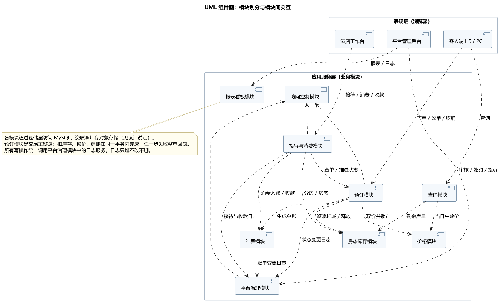

*图 2-3　组件图：模块划分与模块间交互*

### 2.4 关键交互：并发下单时序图

时序图选择并发抢最后一间房这一场景，因为它同时涉及库存、价格、结算三个模块，也最容易出现超卖与重复下单。客人 A、B 同时提交订单：A 的条件更新影响 1 行，扣减成功并继续写订单、生成账单；B 的条件更新影响 0 行，整单回滚并提示“该房型当天已售完”。同一请求重复提交时，预订模块按幂等键查到已有订单，直接返回同一张订单，不重复扣库存。页面价格变化时，系统先返回新旧价格，客人确认后才继续下单。

这张图把实验一中 REQ-022 的三条规则画成了可执行的过程：库存不会被超扣、一个请求只对应一张订单、失败的下单不占用库存；REQ-025 的 2 秒响应与并发要求由同一套条件更新保证。它也是组件图“预订模块是交易主链路”的具体展开。

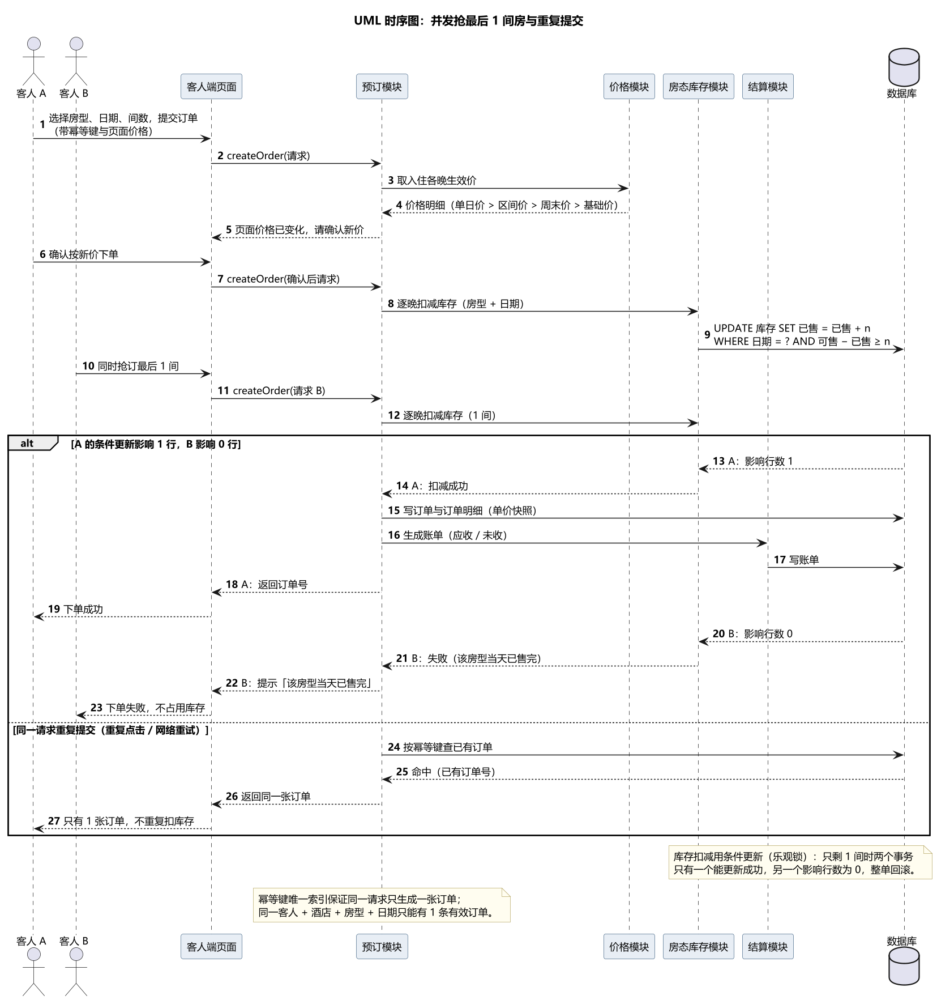

*图 2-4　时序图：并发抢最后 1 间房与重复提交*

### 2.5 模块交互规则与设计原因

| 规则 | 说明 |
|---|---|
| 上层只调用下层 | 表现层 → 应用层 → 领域层 → 基础设施层，不出现反向依赖；领域层定义仓储接口，由基础设施层实现（依赖倒置） |
| 跨模块只走接口 | 例如预订模块只通过库存模块的 deduct/release 改库存，不直接写库存表，保证并发控制只有一处 |
| 写操作必须留痕 | 所有写模块调用平台治理模块的日志服务；日志只增不改不删，保留 3 年；查看手机号全号也写访问记录 |
| 数据范围先于业务 | 每个接口先按角色 + 酒店范围校验，再执行业务，避免“先做业务再补权限”造成越权 |
| 失败整单回滚 | 下单、改单涉及多张表，统一在应用服务层开启事务；库存扣减失败时释放已扣晚次并回滚订单与账单 |

这样设计的原因有三点。其一，实验一的 31 条需求中，异常与边界占了 9 条，必须在结构上为它们留位置：库存条件更新对应并发抢订，幂等键对应重复提交，停售实体对应“已售日期不可停售”，状态机对应“已入住不能直接取消”。其二，酒店侧与平台侧的权限边界必须清楚，平台管理员只能审核与处罚、不能改价格房型，因此审核与处罚放在平台治理模块，价格与房型留在酒店侧模块。其三，实验三要在 500 行以上的原型里落地，模块边界与接口先定下来，后续只需填充实现，不必推翻结构。

| 需求组 | 涉及需求 | 落点模块 | 对应图 |
|---|---|---|---|
| 角色与账号 | REQ-001/002/028 | 访问控制 | 类图、用例图、组件图 |
| 入驻与处罚 | REQ-003/004/005 | 平台治理 | 用例图、组件图 |
| 字典与查询 | REQ-006/010/024 | 查询 | 类图、用例图、组件图 |
| 房态与价格 | REQ-007/008/009/023 | 房态库存、价格 | 类图、组件图、时序图 |
| 预订与订单 | REQ-011/012/013/014/022/025/030 | 预订、结算 | 类图、用例图、时序图 |
| 接待与房间 | REQ-015/016 | 接待与消费 | 类图、用例图、组件图 |
| 消费与账单 | REQ-017/018 | 接待与消费、结算 | 类图、组件图 |
| 投诉与治理 | REQ-019/020/021 | 平台治理、报表看板 | 用例图、组件图 |
| 非功能与范围 | REQ-026/027/029/031 | 架构与部署（设计说明） | 组件图 |

---

## 三、UI 界面设计

### 3.1 设计原则与设计规范

界面采用组件化高保真原型方式设计：以 HTML/CSS 搭建设计令牌与组件库，再用浏览器以 2 倍分辨率导出设计稿。组件拆分（按钮、标签、状态胶囊、卡片、表格、日历、步进器、底部操作栏）与 Figma 的组件/变体思路一致，后续可以直接迁移到 Figma、Pixso 或亿图，也可以作为实验三前端实现的起点。

设计遵循四条原则。第一，一屏一任务：客人端围绕“查—订—看—投诉”，每个页面只完成一个主要动作；桌面端按“工作台”组织，左侧导航固定，右侧内容区聚焦当前任务。第二，关键信息前置：价格、剩余房量、取消规则、含早份数在列表与下单页直接可见。第三，状态可见：订单状态、房间状态、账单已收/未收、投诉处理进度都用颜色与文字双重标识，颜色不是唯一信息载体。第四，不设计与需求冲突的入口：界面中不出现在线支付、押金、发票、评分、优惠券、会员积分，客人端下单页明确写“本平台不收取押金、不支持在线支付”。

视觉规范：主色 #0F6CBD，深蓝 #0B2C4D 用于侧边栏与标题，强调色 #F2A63B 用于提交类按钮，成功 #12805C、警告 #A16207、危险 #C0392B；正文使用微软雅黑，桌面端字号 11–24px，手机端 10–18px；卡片圆角 12px、边框 #E3E9F2。移动端以 390×844 为基准，桌面端以 1440×900 为基准，均采用流式布局。

| 组件 | 用途与出现界面 |
|---|---|
| 查询卡 / 日期格 | 城市、入住离店日期、人数；客人端查询页 |
| 酒店卡片 | 封面、区域、标签、起价、剩余房量；客人端列表 |
| 状态胶囊 | 待入住 / 已入住 / 已退房 / 已取消 / 未到店；订单与工作台 |
| 日历格 | 房型 × 日期的可售数与价格，颜色区分可售/紧张/停售；房态与价格页 |
| 房态小卡 | 房间号与状态，选中后可分房；接待工作台 |
| 账单行 | 房费、早餐、在店消费、取消应扣、应收/已收/未收；订单与退房页 |
| 底部操作栏 | 合计金额 + 提交订单 / 办理入住 / 办理退房；移动端与工作台 |
| 表格与筛选 | 审核、投诉、日志列表；平台后台 |

### 3.2 客人端

客人端覆盖查询、下单、订单与账单、投诉四个界面，对应“查得到、订得上、账算得清”的客人侧链路。

  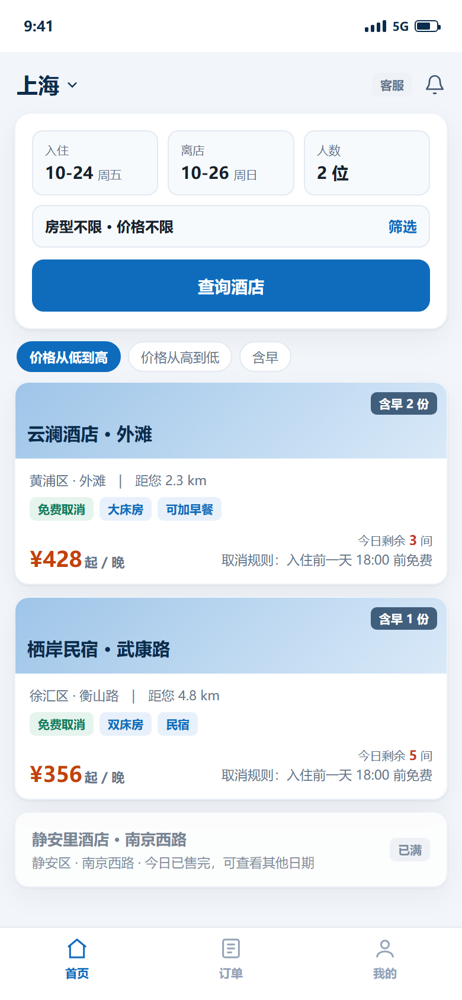
  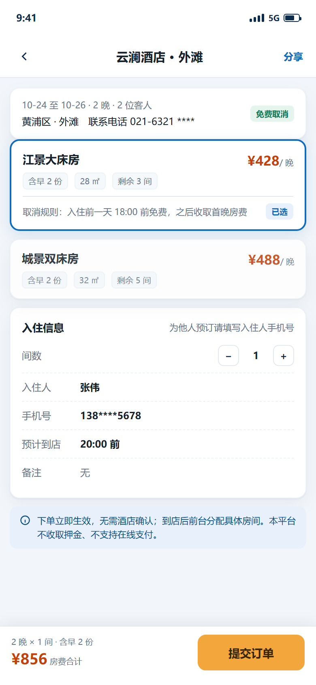

<em>图 3-1　客人端：查询结果　　　　图 3-2　客人端：房型与下单</em>

**界面 1 查询结果**：顶部固定城市、入住/离店日期与人数（三项必填），下方是价格排序切换与酒店卡片。卡片展示酒店名、区域、含早份数、剩余房量、取消规则与起价；当日售完的酒店以灰色“已满”标记并置灰，仍保留在结果中但不可下单。

**界面 2 房型与下单**：酒店信息与房型列表同屏，房型标签直接标出含早份数、面积与剩余间数，取消规则写在卡片内。选择间数、填写入住人与到店时间后，底部固定栏显示房费合计与“提交订单”，并提示不收取押金、不支持在线支付。

  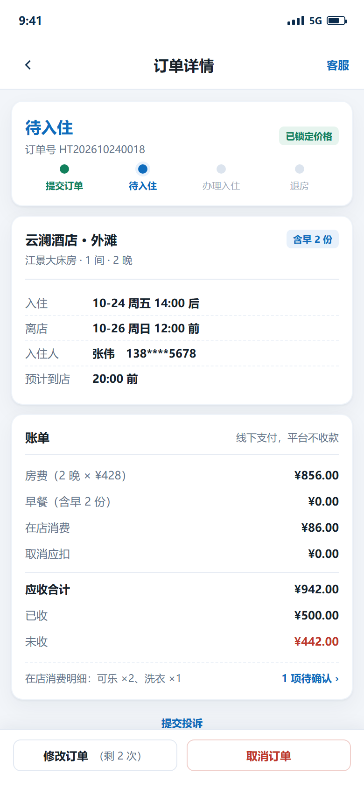
  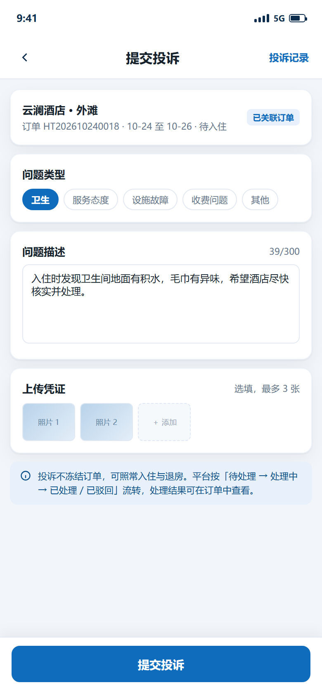

<em>图 3-3　客人端：订单与账单　　　　图 3-4　客人端：提交投诉</em>

**界面 3 订单与账单**：顶部是订单状态时间线与订单号，中部是酒店、房型、日期与入住人，下部是总账：房费、早餐、在店消费、取消应扣、应收合计、已收、未收。消费明细以待确认项提示，底部提供“修改订单（剩 2 次）”与“取消订单”。

**界面 4 提交投诉**：投诉必须从订单进入并自动关联订单号，页面提供问题类型、描述与凭证上传；同时说明“投诉不冻结订单，可照常入住退房”以及“待处理 → 处理中 → 已处理 / 已驳回”的流转。

### 3.3 酒店工作台

酒店工作台面向前台与老板两类账号，覆盖接待、退房结算、房态与价格、房型与商品、报表看板五个界面。前台账号看不到改价、停售与报表入口，体现子账号权限低于主账号的设计。

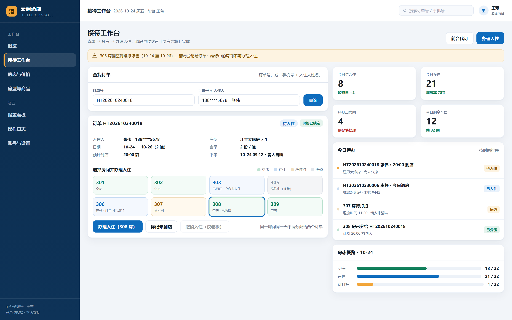

<em>图 3-5　工作台：接待工作台</em>

**界面 5 接待工作台**：左侧查单区支持订单号或“手机号 + 入住人姓名”，查到后展开房型、日期、含早、预计到店与下单来源。分房区用颜色区分空房、在住、待打扫、维修中，选中房间后一键办理入住；维修中的 305 房在顶部横幅提示不可分配。

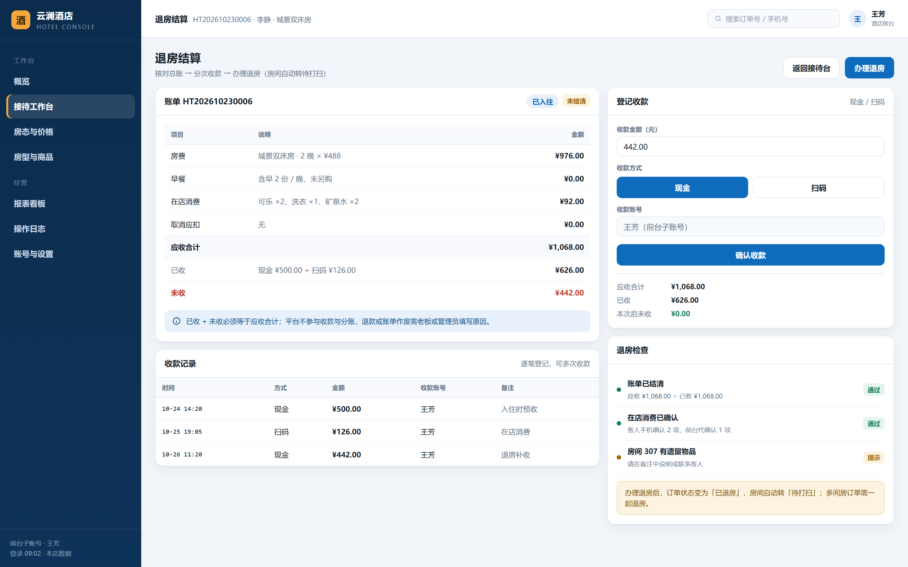

<em>图 3-6　工作台：退房结算</em>

**界面 6 退房结算**：左侧总账按房费、早餐、在店消费、取消应扣、应收合计、已收、未收逐项列出，下方是逐笔收款记录；右侧登记本次收款，并给出“已收 + 未收 = 应收”的校验；退房后房间自动转“待打扫”。

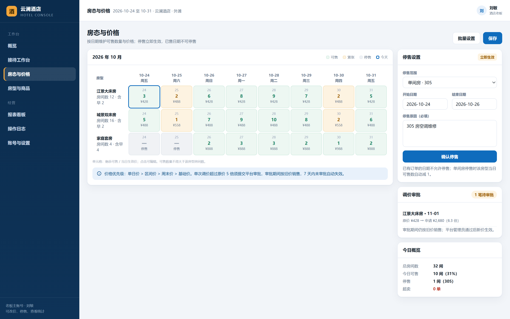

<em>图 3-7　工作台：房态与价格</em>

**界面 7 房态与价格**：以“房型 × 日期”的日历呈现每日可售数量与生效价，颜色区分可售、紧张、停售与今天；右侧停售面板要求选择范围、日期与原因，并提示已有订单的日期不允许停售。

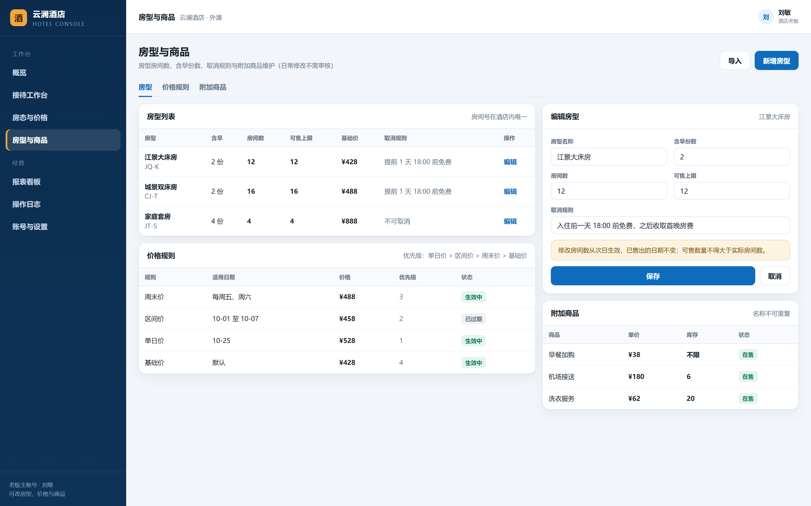

<em>图 3-8　工作台：房型与商品</em>

**界面 8 房型与商品**：房型列表展示含早、房间数、可售上限、基础价与取消规则；右侧编辑区提示“修改房间数从次日生效”；价格规则按优先级排列，附加商品维护名称、单价、库存与状态。

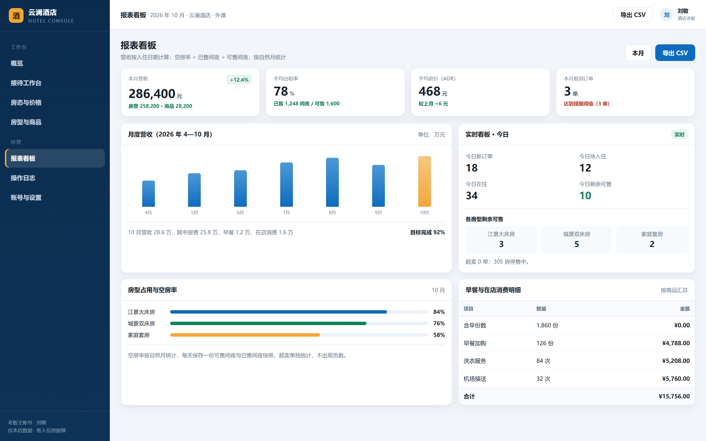

<em>图 3-9　工作台：报表看板</em>

**界面 9 报表看板**：顶部是本月营收、出租率、平均房价、取消订单四个指标；中部是月度营收与实时看板；底部是房型占用率、早餐与在店消费明细，支持导出 CSV。

| 指标 | 口径说明 |
|---|---|
| 月度营收 | 按入住日期统计，住一晚计一晚；房费、早餐、在店消费分列 |
| 出租率 / 空房率 | 已售间夜 ÷ 可售间夜，按自然月；每日保存间夜快照，超卖单独统计不出负数 |
| 平均房价（ADR） | 房费收入 ÷ 已售间夜，不包含附加商品 |
| 取消订单数 | 本月取消的订单数；单店月取消达到 3 次在管理员首页提醒 |

### 3.4 平台管理后台

平台后台面向平台管理员，覆盖入驻审核、投诉与处罚、操作日志三个界面。后台的权限边界在界面上同样可见：管理员可以审核、处罚、作废账单，但页面上没有修改酒店价格与房型的入口。

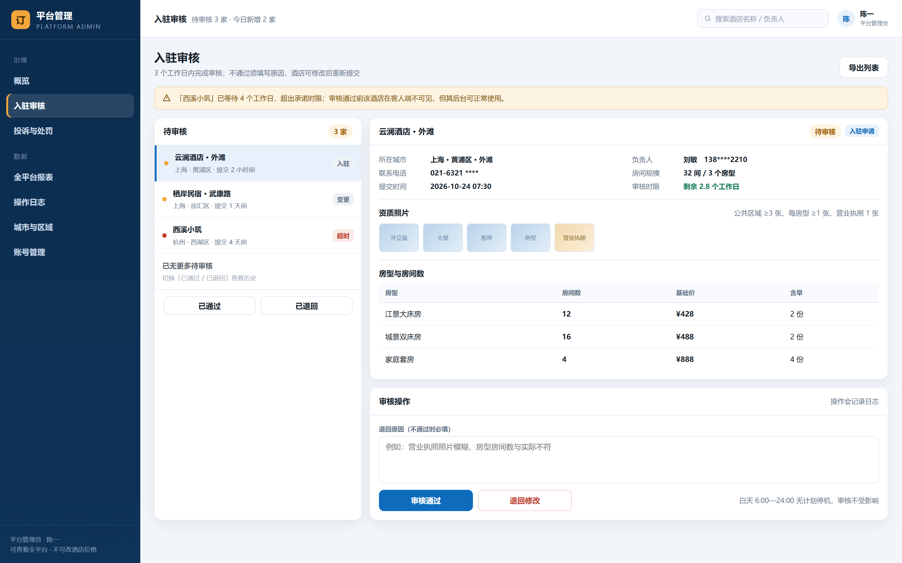

<em>图 3-10　后台：入驻审核</em>

**界面 10 入驻审核**：左侧待审核列表按时间排序，超时申请标红并在顶部提示；右侧展示酒店信息、资质照片与房型房间数，审核不通过须填写原因，页面同时显示剩余审核时限。

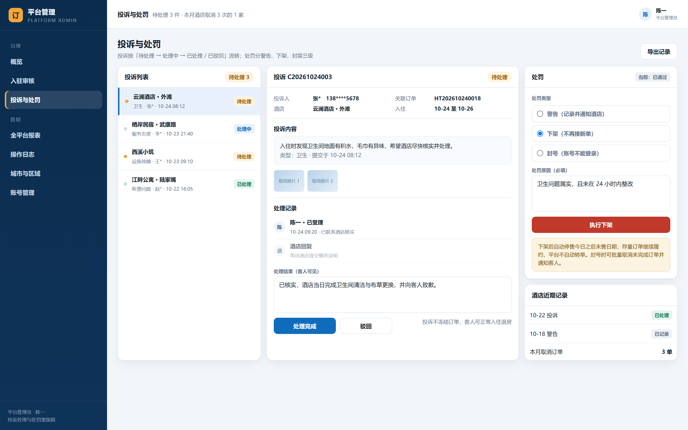

<em>图 3-11　后台：投诉与处罚</em>

**界面 11 投诉与处罚**：左侧投诉列表按状态区分，中部展示投诉内容、凭证与处理记录，右侧是三级处罚与原因，并说明下架自动停售、封号可批量取消未完成订单。

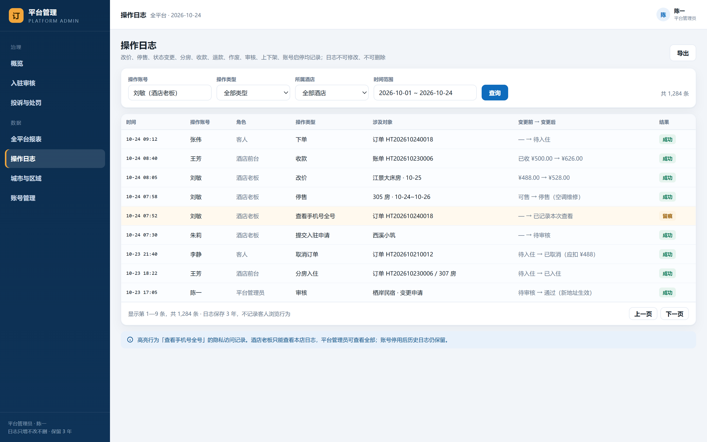

<em>图 3-12　后台：操作日志</em>

**界面 12 操作日志**：顶部按账号、类型、酒店与时间筛选；表格列出时间、账号、角色、操作类型、对象、变更前后与结果，“查看手机号全号”的隐私访问记录被单独高亮。

### 3.5 模块与界面对应关系

| 模块 | 对应界面 | 说明 |
|---|---|---|
| 查询 | 界面 1 | 城市/日期/人数查询、排序、已满标记 |
| 预订 | 界面 2、3 | 房型选择、下单、订单状态与账单 |
| 接待与消费 | 界面 5、6 | 查单分房入住、退房、在店消费与收款 |
| 房态库存 | 界面 5、7 | 房态流转、每日库存、停售 |
| 价格 | 界面 7、8 | 每日价格、价格规则、调价审批 |
| 结算 | 界面 3、6 | 总账、收款记录、未收 |
| 平台治理 | 界面 10、11、12 | 入驻审核、投诉处罚、日志 |
| 报表看板 | 界面 9 | 营收、占用率、实时看板、CSV |
| 访问控制 | 全部界面 | 按角色隐藏入口；前台看不到改价与报表 |
| 投诉 | 界面 4、11 | 客人提交、管理员处理 |

---

## 四、AI 辅助设计过程与工作流

### 4.1 使用过程记录

本次设计全程使用大模型（DeepSeek）辅助，工具链为：大模型负责候选方案与代码草稿，PlantUML 负责 UML 渲染，HTML/CSS + Edge 无头浏览器负责 UI 高保真原型与截图，python-docx 与 LibreOffice Kit 负责报告排版与 PDF 导出。以下按“使用场景—生成结果—问题—修改优化—优缺点”记录 5 次代表性使用。

#### 记录 1：需求梳理与模块划分

使用场景：把实验一的 31 条需求和需求报告交给大模型，要求给出模块划分与架构图。生成结果：18 个模块、包含全部接口的组件图初稿。问题：模块过多（例如把“超卖”单独成模块），与高内聚矛盾；组件图每条接口都画，连线 60 多条完全读不清；还出现了需求中没有的“通知模块”。修改优化：合并为 9 个业务模块，组件图只保留关键调用并加文字说明，删掉需求里不存在的模块，补上实验一明确要求的“停售”“子账号”“日志”。优缺点：模型能快速给出覆盖面很全的候选划分，但不会判断粒度是否合适。

#### 记录 2：PlantUML 绘制与布局调整

使用场景：让大模型把设计写成 PlantUML 代码。生成结果：语法基本可用，但第一次渲染的类图宽 4096 像素被裁剪，时序图文字重叠，用例图一条竖线拉到底。问题：图规模过大、缺少布局控制，中文字体默认显示为方块。修改优化：设置中文字体与 DPI，控制每张图的节点数量与注释数量，把说明从图内移到图下方；类图改为 3 个模块包，时序图只保留并发下单。优缺点：省去手写语法和查文档的时间，但模型对“图的版式”没有直觉。

#### 记录 3：状态机与异常规则核对

使用场景：让大模型根据 REQ-012 画订单状态图、根据 REQ-009 画停售流程。生成结果：状态图初版允许“已入住→已取消”，与需求“已入住订单不得直接取消”矛盾；停售流程没有区分“已售日期不允许停售”。修改优化：对照 requirements.md 逐条核对，把禁止转换写成图上的约束说明，补上“入住日次日 0 点自动标记未到店”“撤销误操作仅老板”。优缺点：状态图结构很快能成型，但对“禁止什么”这类否定式约束容易忽略。

#### 记录 4：图的取舍（16 张精简为 4 张）

使用场景：完整设计阶段先做了 16 张图，后来按课程“至少四种、标志名称”的要求与报告篇幅重新取舍。生成结果：16 张完整图（类图 4、用例图 2、状态图 3、活动图 2、时序图 2、组件图/包图/部署图各 1）。问题：图多不等于讲得清——4 张类图之间要来回对照，状态图与活动图的异常分支和类图注释重复。修改优化：保留“对象—功能—模块—交互”四条主线各一张；状态图、活动图、包图、部署图作为过程稿备份。优缺点：模型能快速产出大量候选图，但“留哪几张、删哪几张”必须由人决定。

#### 记录 5：UI 高保真原型与报告

使用场景：让大模型按设计系统生成 12 个界面的 HTML/CSS 原型，再用浏览器截图；同时起草报告结构与文字。生成结果：12 个界面原型与报告初稿。问题：第一版移动端订单页内容过长、被底部操作栏截断；处罚单选框被通用 input 样式撑满整行；部分文案出现“评分”“支付”等需求范围外的词。修改优化：删减卡片、把消费明细收进账单行；用浏览器逐张截图检查并修正 CSS；对照 REQ-031 清理禁词。优缺点：模型能快速产出风格统一的界面与文字初稿，但布局细节、字段完整性和业务禁词必须人工逐页检查。

### 4.2 工具优缺点分析

| 能力 | 优势 | 局限 |
|---|---|---|
| 需求结构化 | 把口语化访谈整理成字段统一的条目，主动提示缺失项 | 不会主动指出答复之间的矛盾；会按常见产品脑补规模与指标 |
| 模型与图 | 快速给出类、用例、时序的候选结构与 PlantUML 语法 | 对“禁止什么”“边界在哪”容易忽略；布局需要人工调整 |
| UI 原型 | 按设计系统批量生成风格统一的界面与文案 | 响应式细节、字段完整性、业务禁词需要逐页核对 |
| 报告与文档 | 按结构快速起草，术语与格式一致 | 数字、图号、结论容易与设计稿脱节，需要人工核对 |

### 4.3 能否设计一套“人只做检查校对”的工作流

新版实验要求提出：能否设计一套工作流，让人只完成检查校对的工作。我的判断是：在输入稳定、规则显式的项目里，可以做到“人只做判定与签核”，但“检查校对”本身仍是设计判断，不能完全机械化；更现实的目标是“人定规则、AI 生产、自动门禁、人签核”。下面是我尝试设计的工作流。

| 阶段 | AI 负责 | 自动检查（脚本/工具） | 人工检查点 |
|---|---|---|---|
| 1 需求结构化 | 抽取实体、状态、角色、用例，生成需求-ID 映射 | 需求编号唯一、字段齐全、覆盖矩阵缺项 | 确认语义、异常规则、验收标准是否成立 |
| 2 领域模型 | 生成类图、属性、关系与唯一约束 | PlantUML 渲染、类数阈值、命名一致 | 关系与基数、唯一约束、模块归属 |
| 3 行为与交互 | 生成用例图、时序图、状态转换 | 状态白名单、禁止转换黑名单、事务边界标注 | 确认禁止转换、并发与回滚是否符合业务 |
| 4 UI 原型 | 按设计令牌生成页面与组件 | 禁词（支付/押金/评分/优惠券）、字段齐全、步数统计 | 信息架构、操作顺序、权限入口是否正确 |
| 5 一致性审计 | 逐条回答“该需求在哪个图/界面体现” | 需求矩阵比对、图号引用、数字公式（应收=已收+未收） | 判定缺陷是否成立、是否回退修改 |
| 6 报告排版 | 按结构起草、插入图表、统一术语 | 图号连续、数字一致、字数与页数 | 事实、结论、反思是否真实 |

这套流程里，真正可以交给机器的是“可验证的检查”：PlantUML 能否渲染、图的节点是否超过阈值、需求矩阵是否有缺项、界面是否出现禁词、账单公式是否成立、状态转换是否在白名单内、图号与数字是否前后一致。这些检查有明确判定标准，写成脚本或提示词即可重复执行。

但有三类事情无法交给机器。第一，需求确认：某条规则到底该不该这样定，只有甲方与工程师能判断。第二，异常取舍：例如“已入住能不能撤销”“停售与已售订单谁优先”，需要业务权衡，模型倾向于按常见产品习惯回答。第三，图与界面的可读性：哪张图该拆、哪个字段该前置，取决于读者与使用场景。

因此，“人只做检查校对”在有限范围内可行：人先把规则、禁词、状态白名单、验收标准写成显式约束，AI 负责生产候选，自动门禁拦住格式与一致性问题，人只对业务判断签字。若规则没有显式化，人就会被拉回“边生成边判断”，校对的成本可能高于自己写。我的体会是，AI 把设计的“生产”成本降下来了，但把“判断”的重要性抬高了。

### 4.4 小结

本次设计中，AI 在“候选生成、格式统一、批量出图、文字起草”上节省了大量时间；人负责的部分集中在需求确认、异常规则、模块粒度、图的取舍与最终核对。两者配合的关键不是提示词写得多好，而是把约束写清楚、把检查点固定下来，让 AI 的输出可被验证。

---

## 五、总结与后续工作

### 5.1 设计小结

本次设计完成了从需求到结构、行为、交互与界面的完整链路：31 条需求收敛为 9 个业务模块；4 张 UML 图覆盖结构性、行为性、交互性三类，其中类图用 16 个类描述领域模型，用例图用 15 个主要用例描述角色功能，组件图用 9 个模块描述架构与交互，时序图用并发下单说明关键业务的执行过程；12 个界面覆盖客人端、酒店工作台与平台后台。

设计上的重点不是把图画多，而是把实验一中最容易出问题的规则落到结构里：库存按“房型 + 日期”并用条件更新防超卖，幂等键防重复下单，订单 5 状态与终态约束防非法转换，停售与已售订单的冲突有明确拦截，账单保证“已收 + 未收 = 应收”，日志只增不改并记录隐私访问。这些规则在类图约束、组件交互、时序图和界面提示中相互对应。

### 5.2 不足与后续工作

第一，UML 图的自动布局仍有局限：组件图的部分连线较长，类图的模块包位置由布局引擎决定，后续可以手工微调。第二，界面是设计稿而非可运行页面，尚未做可用性测试；实验一要求“5 英寸手机、3 名未使用过系统的人员、主流程不超过 5 步”，需要在实验三用真实页面验证。第三，状态图、活动图、包图、部署图作为过程稿保留在备份中，如果答辩需要可以取回补充。

实验三进入实现阶段后，建议按本设计的模块边界与接口落地，优先实现“查询—下单—分房入住—退房结算”主链路，再补投诉、报表与日志；实现中如果与设计冲突，按课程要求以最新实现为准，并回头更新本设计。

---

## 附：文件与版本

| 内容 | 位置 |
|---|---|
| 实验报告 PDF | `实验报告.pdf`（本文件同目录） |
| UML 图（4 张，puml + png） | `UML/` |
| UI 界面（12 张） | `UI界面/` |
| 完整版 16 张 UML 备份 | `C:\study\rjgc\_backup\UML完整版16张_20261113.zip` |
| 设计说明（补充材料） | `..\实验2_UML设计说明.md` |

> 说明：本文档由报告排版内容同步生成，图号与 PDF 一致；如需修改文字，建议同时更新 PDF，避免两版不一致。
